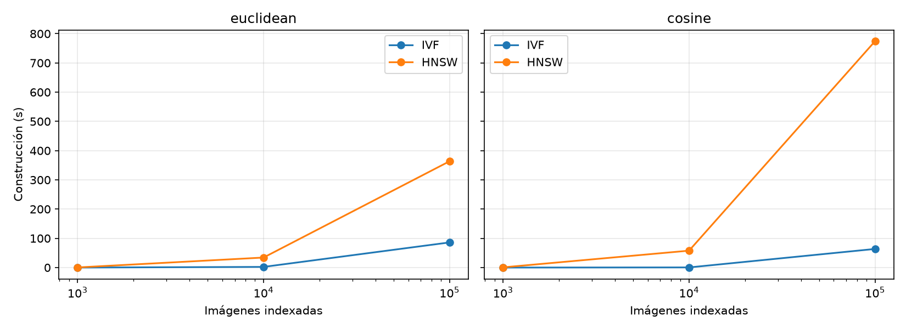
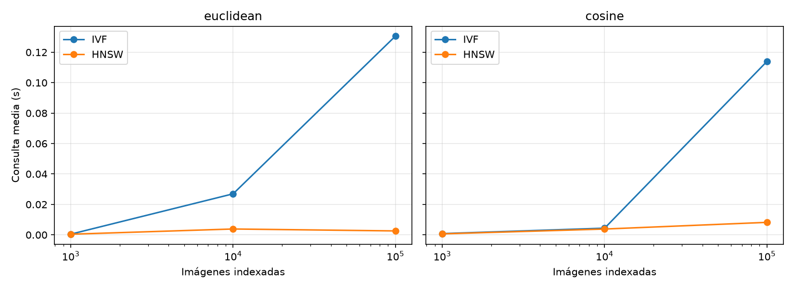
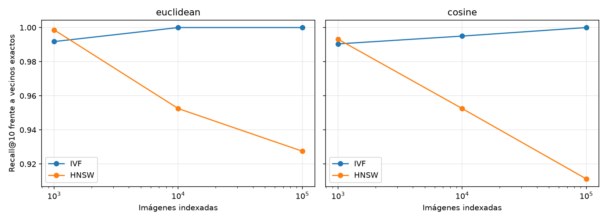
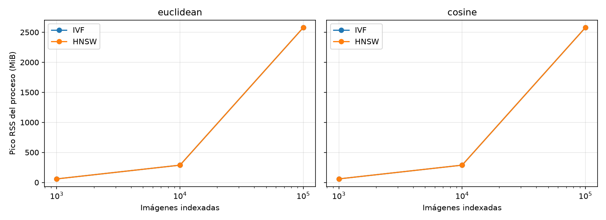

# Comparación experimental multimedia (#59)

Los vectores son promedios SIFT de imágenes COCO. Cada configuración usa el mismo corpus y las mismas consultas; el vector de la consulta se excluye de los resultados. Recall@10 compara los diez IDs recuperados con los diez vecinos exactos bajo la misma métrica. No mide relevancia semántica por categoría. Las imágenes sin puntos SIFT usan un histograma gris de 128 dimensiones escalado al tamaño mediano de los vectores SIFT; casos por tamaño: 1000: 0, 10000: 1, 100000: 1.

| Imágenes | Métrica | Índice | Construcción (s) | Consulta media (ms) | Recall@10 | Pico RSS (MiB) |
|---:|---|---|---:|---:|---:|---:|
| 1000 | cosine | HNSW | 0.724 | 0.643 | 0.993 | 58.8 |
| 1000 | cosine | IVF | 0.023 | 0.830 | 0.990 | 58.9 |
| 1000 | euclidean | HNSW | 0.415 | 0.421 | 0.999 | 58.6 |
| 1000 | euclidean | IVF | 0.029 | 0.459 | 0.992 | 58.8 |
| 10000 | cosine | HNSW | 57.808 | 3.820 | 0.952 | 287.8 |
| 10000 | cosine | IVF | 0.472 | 4.389 | 0.995 | 287.8 |
| 10000 | euclidean | HNSW | 34.258 | 3.851 | 0.953 | 287.8 |
| 10000 | euclidean | IVF | 2.220 | 26.973 | 1.000 | 287.7 |
| 100000 | cosine | HNSW | 774.351 | 8.209 | 0.911 | 2578.3 |
| 100000 | cosine | IVF | 63.694 | 113.972 | 1.000 | 2578.4 |
| 100000 | euclidean | HNSW | 363.576 | 2.577 | 0.927 | 2577.8 |
| 100000 | euclidean | IVF | 85.956 | 130.637 | 1.000 | 2577.5 |

## Recomendaciones basadas en estas corridas

- 1000 imágenes, euclidean: **HNSW** tuvo menor latencia media; **HNSW** obtuvo mayor Recall@10; **HNSW** registró menor pico RSS.
- 1000 imágenes, cosine: **HNSW** tuvo menor latencia media; **HNSW** obtuvo mayor Recall@10; **HNSW** registró menor pico RSS.
- 10000 imágenes, euclidean: **HNSW** tuvo menor latencia media; **IVF** obtuvo mayor Recall@10; **IVF** registró menor pico RSS.
- 10000 imágenes, cosine: **HNSW** tuvo menor latencia media; **IVF** obtuvo mayor Recall@10; **IVF** registró menor pico RSS.
- 100000 imágenes, euclidean: **HNSW** tuvo menor latencia media; **IVF** obtuvo mayor Recall@10; **IVF** registró menor pico RSS.
- 100000 imágenes, cosine: **HNSW** tuvo menor latencia media; **IVF** obtuvo mayor Recall@10; **HNSW** registró menor pico RSS.

Estos resultados corresponden a una sola corrida por configuración, sin intervalos de confianza. El pico RSS incluye el intérprete y las páginas compartidas; no representa la memoria exclusiva del índice. Para comparar máquinas o tomar decisiones de producción hay que repetir las corridas bajo condiciones controladas.

[Galería de casos](gallery.html)
