# Informe del Proyecto — Base de Datos II

Minigestor de base de datos multimodal construido desde cero en Python (UTEC, Base de Datos II, 2026-2). Este informe es incremental y crece con cada entrega:
- **Partes 1 y 2:** se documentan el diseño arquitectónico, el dominio de datos, los algoritmos y la comparación experimental.
- **Instalación y uso:** están en el [README](../README.md).

| Sección | Contenido |
| :--- | :--- |
| [1. Arquitectura del motor](#1-arquitectura-del-motor) | Componentes, recorrido de una consulta y dominio de datos relacional. |
| [2. Decisiones de diseño y algoritmos](#2-decisiones-de-diseño-y-algoritmos) | Almacenamiento, índices, concurrencia, SQL, algoritmos externos e interfaz. |
| [3. Resultados experimentales (Parte 1)](#3-resultados-experimentales-y-benchmarks) | Heap vs Secuencial; B+ agrupado vs no agrupado vs Hash; complejidad. |
| [4. Diseño de la Parte 2](#4-diseño-e-implementación) | Arquitectura espacial, dominio de datos, métricas, R-Tree, SQL y mapa. |
| [5. Resultados experimentales (Parte 2)](#5-comparación-experimental-secuencial-vs-r-tree-vs-gist) | Secuencial vs R-Tree vs GiST. |

## Avance 1: Motor Relacional

### 1. Arquitectura del Motor

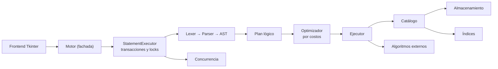

- **Almacenamiento** (`engine/storage/`): Heap File (*slotted pages*), Archivo Secuencial Paginado y tabla organizada como B+ agrupado.
- **Índices** (`engine/indexes/`): B+ agrupado, B+ no agrupado y Hash extensible.
- **Consultas** (`engine/query/`): lexer, parser, plan lógico, optimizador por costos, ejecutor y algoritmos externos.
- **Concurrencia** (`engine/concurrency/`): locks de granularidad múltiple (IS/IX/S/SIX/X) con 2PL estricto, detección de deadlocks y transacciones con *undo log*.
- **Frontend** (`frontend/`): interfaz Tkinter (archivos, consultas, resultados y plan de ejecución) en modo demo.

**Recorrido de una consulta:**
1. El `StatementExecutor` abre la transacción de la sentencia y toma los locks necesarios.
2. El parser produce el AST, que se convierte en un plan lógico.
3. El optimizador estima el costo de cada ruta de acceso (recorrer la tabla, B+, hash) y de cada algoritmo (sort, group by y join, en memoria o externos), y elige el más barato.
4. El ejecutor produce las filas de forma incremental.
5. Cada escritura actualiza los índices y las estadísticas a través del catálogo.

#### 1.1 Dominio de datos (Parte 1)
- **Modelo:** tablas relacionales con registros de largo fijo.
- **Tipos:**
  - `INT`: entero de 8 bytes;
  - `FLOAT`: real de 8 bytes;
  - `VARCHAR(n)`: n bytes UTF-8, cortados en un carácter completo.

  Los registros no admiten `NULL`.
- **Restricciones:** `PRIMARY KEY` única y `FOREIGN KEY` con `RESTRICT` o `CASCADE`.
- **Datos de los experimentos:** registros `(id INT, nombre VARCHAR(20), precio FLOAT)` de 36 bytes, con ids únicos 0..N-1 insertados en orden aleatorio (`benchmarks/generate_datasets.py`, semilla 42).
- **Datos de la interfaz:** el modo demo crea `cuentas (id, nombre, saldo)` y `productos (id, nombre, precio)`. Cualquier CSV se puede cargar con `COPY` o con el botón **Cargar CSV...**.

### 2. Decisiones de Diseño y Algoritmos

#### 2.1 Heap File con Arquitectura Slotted Page
Se implementó el almacenamiento en disco mediante páginas de tamaño fijo (**4096 bytes / 4 KB**), alineadas con el tamaño de bloque del sistema operativo y hardware de almacenamiento.

* **Estructura de Página**:
  - **Header (4 bytes)**: `num_slots` (uint16) y `data_end` (uint16).
  - **Área de Datos**: Crece desde el inicio (byte 4) hacia adelante.
  - **Directorio de Slots**: Crece desde el final (byte 4096) hacia atrás. Cada slot ocupa **5 bytes** (`offset: 2B`, `length: 2B`, `is_deleted: 1B`).
  - **Espacio Libre**: Bloque continuo en el centro (`slot_dir_start - data_end`), evitando fragmentación y eliminando la necesidad de desplazar datos en memoria.

* **Estabilidad de Punteros (RID)**:
  - Cada registro es identificado de forma única por un `RID(page_id, slot_id)`.
  - Se utiliza **eliminación lógica** (`is_deleted = 1` en el slot), preservando la posición física del slot para que los índices externos (B+ Tree y Hash) no queden corruptos.

* **Reutilización de Espacio**:
  - En inserciones, el motor primero busca slots marcados como eliminados para sobreescribir su espacio antes de consumir nuevo espacio contiguo.
  - El motor mantiene en memoria un conjunto `free_pages` con las páginas que tienen espacio para un slot nuevo o un slot borrado reutilizable. Se reconstruye al abrir el archivo y se actualiza en cada inserción y eliminación, sin escaneos completos de disco por operación.

#### 2.2 Archivo Secuencial Paginado (Sequential File)
Diseñado para tablas con orden físico por clave primaria o de ordenamiento, combinando páginas ordenadas con un área de desborde y reorganización periódica.

* **Estructura Física Dual (`main` y `aux`)**:
  - **`main`**: Páginas donde los registros y el directorio de slots se mantienen estrictamente ordenados por clave.
  - **`aux`**: Archivo de desborde (*overflow*) sin orden para inserciones rápidas cuando la página destino de `main` no cuenta con espacio suficiente.
  - **Identificador `RID(page_id, slot_id, file)`**: Registra el archivo de origen (`"main"` o `"aux"`), permitiendo accesos y eliminaciones transparentes.

* **Búsqueda e Inserción Binaria en Dos Niveles**:
  - **Nivel de Archivo**: Búsqueda binaria sobre separadores en memoria (`_page_max`, el máximo de cada página de `main`). Si una página queda vacía conserva su último máximo como separador, de modo que la búsqueda binaria no se desvía.
  - **Nivel de Página**: Búsqueda binaria (*lower bound*) sobre el directorio de slots con `_find_insert_position_in_page`.
  - **Inserción ordenada eficiente**: `insert_sorted_at` desplaza únicamente las entradas del directorio de slots (5 bytes por slot), sin reubicar los datos de los registros. Si la página destino está llena, el registro se agrega **al final** de `aux` (sin recorrer `aux` buscando huecos).
  - **Búsqueda por clave y por rango**: `search_by_key` devuelve todas las coincidencias (admite claves repetidas) recorriendo `main` desde el *lower bound*; las claves de `aux` se ubican con un índice en memoria (clave → RIDs) que se reconstruye al abrir el archivo, se mantiene en cada inserción y borrado y se vacía al reorganizar, así la búsqueda no recorre el área de desborde; `range_search(lower, upper)` mezcla (*merge*) el tramo ordenado de `main` con las coincidencias de `aux` (admite límites abiertos y exclusivos).
  - **Uso desde SQL**: la clave de ordenamiento se registra como un índice virtual (`SequentialKeyIndex`), así que el optimizador resuelve `WHERE clave = v`, rangos y `ORDER BY clave` con esta búsqueda binaria (`EXPLAIN` muestra `Index Scan using <tabla>_pkey`) en lugar de recorrer el archivo. Sus RIDs se calculan en cada consulta y no envejecen al reorganizar.

* **Eliminación Lógica**:
  - Marca `is_deleted = 1` en el slot sin compactación inmediata y actualiza los límites de la página. La eliminación nunca dispara una reorganización, así los RIDs de un lote de borrado siguen siendo válidos.

* **Inestabilidad de RIDs en `main` (Trade-off de Diseño)**:
  - A diferencia del Heap File, los RIDs devueltos por inserciones en `main` no son estables: una inserción posterior en la misma página desplaza el `slot_id` de los registros existentes y una reorganización reescribe el archivo. El acceso recomendado es mediante `search_by_key`/`range_search`, y los índices secundarios deben reconstruirse tras modificar la tabla.

* **Disparadores de Reorganización**:
  - `needs_reorganization()` usa contadores en memoria (registros activos y borrados en `main`, registros en `aux`) y devuelve verdadero si:
    1. el **espacio desperdiciado supera el 30%**: `(borrados_main + registros_aux) / total > 0.30`, o
    2. `aux` supera **⌈log₂(páginas de main + 1)⌉ páginas**. Este segundo límite (decisión propia) mantiene la búsqueda en O(log P) lecturas: sin él, con inserciones aleatorias casi todos los registros terminaban en `aux` y la búsqueda degeneraba en un recorrido lineal.
  - Con `auto_reorganize=True` (valor por defecto) la verificación se hace **antes** de cada inserción, de modo que el RID devuelto sigue siendo válido al retornar.

* **Reorganización con `fill_factor` (Decisión Propia de Diseño)**:
  - `main` ya está ordenado, así que se recorre en *streaming*; solo `aux` (acotado por el disparador) se ordena en memoria. Ambos flujos se combinan con un *merge* y se escriben en un archivo nuevo que reemplaza a `main` al terminar (`os.replace`); los registros eliminados se purgan y `aux` queda vacío.
  - Las páginas nuevas se llenan al **90% (`fill_factor = 0.9`)**. La holgura del 10% admite inserciones ordenadas directamente en `main` sin desbordar de inmediato hacia `aux`.

#### 2.3 Índice Hash Dinámico (Extendible Hashing)

Implementado en `engine/indexes/extendible_hash.py` para acelerar búsquedas por igualdad sobre registros almacenados en Heap File o Sequential File. El índice mantiene un directorio global y buckets con capacidad configurable, adaptando su estructura mediante divisiones y fusiones.

* **Directorio Global y Buckets**:
  - El directorio contiene `2 ** global_depth` referencias a buckets. Inicialmente, la profundidad global es **1** y existen **dos buckets** con profundidad local **1**.
  - Cada bucket almacena pares **`(clave, RID)`**, conservando el registro completo en el archivo de datos. El RID incluye `page_id`, `slot_id` y `file`, permitiendo distinguir `main` y `aux`.
  - `bucket_capacity` limita la cantidad de pares por bucket (**4 por defecto**). Varias entradas del directorio pueden apuntar al mismo bucket cuando su profundidad local es menor que la global.

* **Función Hash y Profundidades**:
  - Se utiliza **BLAKE2b de 64 bits** sobre una representación estable de la clave, evitando la variación de `hash(str)` entre procesos de Python.
  - Los bits menos significativos seleccionan la posición del directorio mediante `hash_clave & ((1 << global_depth) - 1)`. La profundidad global determina cuántos bits se consultan y la local cuántos identifican a cada bucket.
  - Se admiten claves `int`, `float` finitos y `str`. Valores numéricamente iguales, como `1` y `1.0`, se consideran la misma clave.

* **Inserción, Split y Duplicación del Directorio**:
  - `insert(key, rid)` localiza el bucket y agrega el par si existe espacio. Las claves repetidas con distintos RIDs están permitidas; un par idéntico no se inserta dos veces.
  - Si el bucket está lleno y sus entradas pueden separarse, se incrementa su profundidad local, se crea un bucket hermano y se redistribuyen los pares según el nuevo bit disponible.
  - Cuando la profundidad local iguala la global antes del split, se duplica el directorio y se incrementa la profundidad global, conservando las referencias a los buckets que no se dividen.

* **Colisiones y Buckets de Desborde (Decisión de Diseño)**:
  - Las claves repetidas y los hashes que no se pueden separar con los bits disponibles utilizan una cadena de buckets de desborde, cada uno sujeto a `bucket_capacity`.
  - `max_depth` limita el crecimiento del directorio (**16 por defecto**, configurable entre **1 y 20**). Al alcanzar ese límite también se utiliza desborde, evitando divisiones indefinidas.

* **Búsqueda por Igualdad**:
  - `search(key)` accede al bucket indicado por el hash y recorre sus entradas y su cadena de desborde, comparando las claves para distinguir colisiones.
  - Devuelve todos los RIDs coincidentes, o una lista vacía si la clave no existe. Los registros completos se recuperan mediante `storage.get(rid)`; el índice no implementa búsquedas por rango.

* **Eliminación, Merge y Contracción**:
  - `delete(key, rid)` elimina un par específico; sin RID, elimina todas las entradas de la clave. La operación devuelve la cantidad de pares eliminados y compacta la cadena de desborde.
  - Se fusionan buckets hermanos cuando tienen la misma profundidad local y sus entradas combinadas caben en un solo bucket. Las referencias del directorio se actualizan al bucket resultante.
  - Si ambas mitades del directorio contienen las mismas referencias, este se reduce a la mitad. La contracción se repite hasta donde sea posible, manteniendo una profundidad global mínima de **1**.

* **Carga Masiva e Integración con Storage**:
  - `bulk_load` recibe un iterable de pares `(clave, RID)`. `bulk_load_from_storage` obtiene esos pares recorriendo los registros activos del archivo mediante `scan()` y extrayendo el campo indexado.
  - Se agregó `SequentialFile.scan()` para recorrer `main` y `aux` con sus RIDs físicos actuales, omitiendo registros eliminados. La fuente se procesa de forma incremental, mientras el índice resultante reside en memoria.
  - La carga desde storage reconstruye el índice por defecto: solo reemplaza la estructura anterior cuando termina correctamente. Si falla, conserva el índice anterior; durante la construcción ambas estructuras ocupan memoria.
  - Las inserciones ordenadas y reorganizaciones del Sequential File pueden invalidar RIDs existentes, por lo que requieren reconstruir el índice antes de consultarlo. Desde SQL, el catálogo sincroniza storage e índices automáticamente (sección 2.6); quien use el índice directamente debe sincronizarlo.

* **Persistencia Opcional y Alcance**:
  - El directorio y los buckets operan en memoria. Al especificar `filepath`, se guarda un **snapshot JSON versionado** con la configuración y los pares mediante `flush()`, `close()` o al salir de un bloque `with`.
  - El guardado escribe un archivo temporal y reemplaza el destino al terminar. Al reabrir, se reconstruye el directorio a partir de las entradas persistidas.
  - Esta implementación no utiliza páginas de buckets en disco ni proporciona transacciones entre el índice y el storage. `stats()` reporta profundidad, entradas, buckets únicos, desborde y ocupación sin contar dos veces las referencias compartidas.

* **Validación mediante Pruebas**:
  - Las pruebas cubren splits con y sin duplicación del directorio, claves repetidas, colisiones forzadas, eliminación y fusión de buckets, y operaciones aleatorias contrastadas con un modelo de referencia.
  - También verifican carga masiva desde ambos storages, reconstrucción tras cambios de RIDs y persistencia entre procesos, incluyendo la conservación del snapshot anterior ante un fallo de guardado.

#### 2.4 Transacciones y Control de Concurrencia

Implementado en `engine/concurrency/` (`LockManager`, `TransactionManager`) y `engine/query/statement_executor.py`. Cada usuario (o hilo) tiene su propia sesión SQL (`StatementExecutor`); el catálogo, el `LockManager` y el `TransactionManager` se comparten entre sesiones.

* **Transacciones**: `BEGIN [TRANSACTION]`, `END [TRANSACTION]` / `COMMIT` y `ROLLBACK`. Una sentencia fuera de una transacción se ejecuta en modo *autocommit*. Cada INSERT y DELETE registra su inversa en un *undo log*; el ROLLBACK la aplica en orden inverso antes de liberar los locks.

* **Locks de granularidad múltiple con 2PL estricto**: los locks se piden durante la transacción y se liberan todos juntos en COMMIT/ROLLBACK.

  | Sentencia | Lock sobre la tabla | Lock sobre la fila (clave) |
  | :--- | :---: | :---: |
  | `SELECT` | S | — |
  | `INSERT` | IX | X |
  | `DELETE` | SIX (lee la tabla para evaluar el WHERE) | X |

  Matriz de compatibilidad ("Sí" = pueden coexistir):

  | Pedido ↓ / Tenido → | IS | IX | S | SIX | X |
  | :---: | :---: | :---: | :---: | :---: | :---: |
  | **IS** | Sí | Sí | Sí | Sí | No |
  | **IX** | Sí | Sí | No | No | No |
  | **S** | Sí | No | Sí | No | No |
  | **SIX** | Sí | No | No | No | No |
  | **X** | No | No | No | No | No |

  Consecuencias: varias transacciones pueden insertar claves distintas en paralelo (IX es compatible con IX); un SELECT espera a que terminen las escrituras sin confirmar, por lo que **no hay lecturas sucias**; y una transacción que lee y luego escribe convierte su S en SIX (*upgrade*).

* **Detección de deadlocks**: antes de esperar un lock, el `LockManager` construye el grafo de espera (*wait-for graph*) y busca un ciclo con DFS. Si la espera cerraría un ciclo, lanza `DeadlockError`; la sesión aborta **toda** la transacción (ROLLBACK), libera sus locks y la otra transacción continúa. El cliente reintenta la abortada tras una espera aleatoria (*backoff*). El caso típico es el de dos transacciones que leen la misma tabla (S) y luego ambas intentan escribir (SIX).

* **Latches físicos**: además de los locks lógicos, cada archivo (`HeapFile`, `SequentialFile`) y cada tabla del catálogo tienen un *latch* corto (`threading.RLock`). Protege el descriptor de archivo compartido (`seek` + `read`/`write` no es atómico entre hilos), la lectura-modificación-escritura de páginas y la reconstrucción de índices. Regla de orden: primero el lock lógico y después el latch; **nunca se espera un lock reteniendo un latch**, así no aparecen deadlocks invisibles para el detector.

* **Rollback robusto**: los RIDs del Sequential File cambian al insertar en una página o al reorganizar, por lo que el undo no confía solo en el RID guardado: si ya no contiene el registro, lo localiza por clave (`search_by_key`) o por contenido. Cada operación deshecha actualiza también los índices (fila por fila en el heap; reconstrucción al final en el secuencial y en el B+ agrupado).

* **Demostración** (`python -m benchmarks.concurrency_demo`, verificada también en `tests/concurrency/`). Usa el motor real con sentencias SQL:
  1. **Race condition sin control**: dos hilos leen el saldo (1.000), restan 100 y 200 y escriben directamente en el archivo; el resultado es 800 en vez de 700 (*lost update*).
  2. **La misma operación con transacciones**: tres usuarios hacen `BEGIN TRANSACTION; SELECT ...; DELETE ...; INSERT ...; END TRANSACTION` tres veces cada uno. Los conflictos aparecen como deadlocks; las transacciones abortadas se deshacen y se reintentan, y el saldo final es exacto (1.000 − 3·(10+20+30) = 820).
  3. **Transacciones simultáneas**: cuatro transacciones insertan 50 cuentas cada una con intervalos de ejecución solapados; se guardan las 200 filas.
  4. **Lectura sucia evitada**: un SELECT lanzado mientras otra transacción tiene una inserción sin confirmar espera, y tras el ROLLBACK no ve la fila.
  5. **Deadlock explícito**: de dos transacciones que se esperan mutuamente, una se aborta y la otra confirma.

#### 2.5 Índices B+ (agrupado y no agrupado)

Implementados en `engine/indexes/bplus_tree.py` y especializados en `bplus_tree_clustered.py` y `bplus_tree_unclustered.py`.

* **Organización en disco**: la página 0 guarda el *header* (orden M, raíz, hoja más a la izquierda, cantidad de páginas y una firma del esquema). Cada nodo ocupa una página de 4096 B. M se elige para que un nodo lleno quepa en la página: **M = 254** en el no agrupado (clave entera + RID empaquetado de 8 B) y **M = 92** en el agrupado (clave + registro de 36 B).
* **Invariante**: cada separador de un nodo interno es igual a la primera clave de su subárbol derecho, y las hojas forman una lista enlazada (`nextLeaf`) que permite recorrer rangos en orden.
* **Inserción en O(altura)**: se baja a la hoja y se inserta ordenado. Si la hoja desborda, se divide y la primera clave de la mitad derecha sube al padre (el split puede propagarse hasta crear una nueva raíz). Si la clave nueva queda primera en su hoja, se actualiza un único separador en el ancestro correspondiente.
* **Eliminación en O(altura)**: si el nodo queda por debajo del mínimo, primero intenta **redistribuir** con un hermano y, si no se puede, **fusiona**. En nodos internos el separador del padre rota (baja al nodo y sube la clave del hermano) o baja al fusionar. Ninguna operación vuelve a leer subárboles completos: una prueba acota las páginas leídas por operación a 4·altura + 2.
* **B+ agrupado**: las hojas guardan los registros completos ordenados por una clave única. Desde SQL se crea con `CREATE TABLE ... USING BTREE` (`ClusteredBPlusFile`): la tabla **es** el árbol y su clave se registra como índice agrupado para igualdad, rangos y ORDER BY.
* **B+ no agrupado**: las hojas guardan pares (clave, RID) y admiten claves repetidas; los registros siguen en el heap o el secuencial. Desde SQL se crea con `CREATE INDEX ... USING BTREE`.

#### 2.6 Procesamiento de Consultas SQL

El pipeline está en `engine/query/`: `lexer` → `parser` (descenso recursivo, con mensajes de error que indican línea y columna) → AST → `LogicalPlanner` → `SQLOptimizer`/`QueryPlanner` → `SQLExecutor`.

* **Plan lógico**: `Scan`, `Filter`, `Join`, `Aggregate`, `Distinct`, `Sort`, `Project`, `Limit`, `Insert` y `Delete`. La validación semántica (columnas inexistentes o ambiguas, columnas fuera de GROUP BY, agregados en el WHERE, etc.) ocurre al planificar, antes de leer datos.
* **Optimizador por costos**: usa el modelo de System R y PostgreSQL, que suma E/S y CPU, con estadísticas del catálogo (filas, páginas, valores distintos y mínimo/máximo por columna). La unidad es una lectura secuencial de página. Un recorrido cuesta `páginas + filas · (cpu_tuple + cpu_operator)`. Un índice no agrupado cuesta `descenso + k · cpu_index_tuple + páginas(k) · random_page_cost + k · cpu_tuple`, donde `páginas(k) = P · (1 − (1 − 1/P)^k)` es la fórmula de Cardenas: k filas repartidas en P páginas nunca leen más de P. Un índice agrupado cuesta las páginas contiguas del rango. Con `LIMIT`, un recorrido ordenado se detiene tras `limit / selectividad` filas. `random_page_cost` = 4 como en PostgreSQL; las constantes de CPU (0,1 / 0,05 / 0,025) conservan sus proporciones, pero son 10 veces mayores porque procesar una fila en Python cuesta mucho más que en C. Así decide entre:
  - scan secuencial, `index_scan` (igualdad con hash o B+) o `index_range_scan` (`<`, `<=`, `>`, `>=`, `BETWEEN` con B+; la selectividad se interpola con el mínimo y máximo de la columna);
  - `external_sort` o recorrido ordenado del índice para ORDER BY;
  - `external_hash_group_by` o agrupación sobre un recorrido ordenado para GROUP BY;
  - `external_hash_join` o *index nested loop join* para JOIN.
* **EXPLAIN y EXPLAIN ANALYZE** (`engine/query/explain.py`): muestran el plan con el formato de texto de PostgreSQL (`Seq Scan`, `Index Scan [Backward] using … on …`, `Sort`, `HashAggregate`/`GroupAggregate`, `Hash Join`, `Nested Loop`, `Limit`, `Unique`) con `Index Cond`, `Filter`, `Sort Key`, `Group Key` y `Hash Cond`. Los costos son los del modelo del motor, en lecturas secuenciales de página. `ANALYZE` ejecuta la sentencia midiendo cada operador (tiempo hasta la primera y la última fila, filas reales y ejecuciones) y agrega `Rows Removed by Filter`, `Sort Method`, `Planning Time` y `Execution Time`. Así se compara lo estimado contra lo medido; por ejemplo, para `WHERE nota >= 14` sobre 1.000 alumnos se estiman 333 filas (interpolando entre la nota mínima y la máxima) y se obtienen 355.
* **Validación del modelo de costos**: sobre la demo de 10.000 pedidos (121 páginas), con un B+ no agrupado sobre `monto`, se ejecutó cada consulta forzando ambas rutas. El modelo cambia de índice a recorrido entre 5.000 y 6.000 filas, y los tiempos medidos se cruzan en ese mismo tramo:

  | Consulta | Filas | Elegido | Recorrido | Índice |
  |---|---|---|---|---|
  | `monto > 4990` | 20 | Índice | 273,5 ms | 2,4 ms |
  | `monto > 4500` | 986 | Índice | 220,7 ms | 39,8 ms |
  | `monto > 2500` | 5.015 | Índice | 218,3 ms | 203,4 ms |
  | `monto > 2000` | 6.005 | Recorrido | 221,8 ms | 234,6 ms |
  | `monto > 100` | 9.830 | Recorrido | 228,3 ms | 391,0 ms |
  | `ORDER BY monto DESC LIMIT 10` | 10 | Índice | 1.476,5 ms | 31,8 ms |

  Los tiempos incluyen la medición por operador de `EXPLAIN ANALYZE` y se tomaron con los archivos en la caché del sistema; en un disco frío el índice pierde parte de su ventaja, lo que `random_page_cost` representa. Una tabla de una página, como `productos`, siempre usa el recorrido: `1 + filas · cpu` nunca supera al descenso más una lectura aleatoria.
* **Llaves foráneas**: `REFERENCES padre(pk) [ON DELETE RESTRICT | CASCADE]` (la columna padre debe ser su clave primaria). INSERT y COPY verifican que el padre exista tomando un lock S sobre esa fila, de modo que una transacción que inserta un hijo y otra que borra el padre se serializan. DELETE en el padre aplica `RESTRICT` (error si hay hijas, también cuando se llega a ellas por una cascada) o `CASCADE` (elimina las hijas recursivamente antes que el padre, así un ROLLBACK restaura el padre primero; las filas que se referencian a sí mismas no generan ciclos). Cada columna hija recibe un índice hash automático para que buscar hijas no requiera recorrer la tabla. Además, toda sentencia es atómica: si falla dentro de una transacción se deshace solo lo que ella hizo (*savepoint* implícito).
* **Clave primaria y carga de CSV**: `PRIMARY KEY` rechaza duplicados (comprobación hecha con el lock X de la fila, por lo que dos transacciones no pueden insertar la misma clave) y crea el índice implícito `<tabla>_pkey`. `COPY ... FROM 'archivo.csv'` (sintaxis de PostgreSQL) valida el archivo completo antes de insertar e informa la línea del primer error; la carga es una única transacción.
* **Mantenimiento de índices**: en el Heap File cada INSERT/DELETE actualiza los índices fila por fila; en el secuencial y en el B+ agrupado, cuyos RIDs se mueven, los índices secundarios se reconstruyen una vez al final de la sentencia. Las estadísticas se ajustan por fila y se recalculan completas cada 50 + 10% de cambios (*auto-analyze*), y también al terminar una sentencia que cambió al menos tantas filas como tenía la tabla en el último cálculo (por ejemplo, un `COPY` sobre una tabla vacía). Como el tamaño analizado se duplica en cada disparo, el costo sigue siendo amortizado O(1) por fila.
* **Validación contra SQLite**: `tests/query/test_sqlite_oracle.py` carga los mismos datos en el motor y en SQLite y compara 59 consultas (filtros, expresiones, ORDER BY, LIMIT/OFFSET, GROUP BY/HAVING, DISTINCT, agregados DISTINCT y JOIN) sobre heap con índices, secuencial y B+ agrupado.

#### 2.7 Algoritmos Externos

Implementados en `engine/query/external_algorithms.py` siguiendo el modelo de buffer de **B páginas de R registros** (por defecto B = 8 y R = 128). Los temporales usan un formato binario propio y se eliminan al terminar. Como en PostgreSQL, cada operador trabaja en memoria mientras su entrada cabe en el buffer y solo crea temporales cuando lo excede; así una consulta pequeña no paga el costo de crear archivos.

* **External sort (ORDER BY)**: si la entrada cabe en B·R registros la ordena en memoria (`Sort Method: in-memory` en EXPLAIN ANALYZE). Si no, genera *runs* ordenados de B·R registros y los mezcla con un *merge* k-way de hasta B−1 runs por pasada, con tantas pasadas como haga falta. Admite varias claves y ASC/DESC por clave, y es estable. Además ubica los NULL al principio o al final. Las tablas no guardan NULL (sección 1.1), pero sí pueden aparecer en resultados intermedios, por ejemplo un `NULL` literal en el `SELECT` o `MAX` sobre cero filas.
* **External hash GROUP BY**: agrega en una tabla en memoria mientras los grupos quepan en (B−2)·R. Si se excede, cada grupo ya acumulado se escribe en su partición como estado parcial (cantidad y acumulado, que se combinan al releerlo) y el resto de la entrada se reparte en B−1 particiones con una función hash distinta por nivel y agrega cada partición con una tabla en memoria de hasta (B−2)·R grupos. Si una partición no cabe, se vuelve a particionar; ante *skew* sin progreso recurre a ordenar y agregar en orden. Los agregados DISTINCT eliminan duplicados (grupo, valor) con el mismo mecanismo antes de agregar.
* **External hash JOIN (Grace)**: si la entrada derecha (el nodo `Hash` del plan) cabe en (B−2)·R registros, construye la tabla en memoria y sondea la izquierda en *streaming*. Si no, particiona ambas entradas con la misma función, construye una tabla sobre la partición más chica y la sondea con la otra; con *skew* procesa bloques de (B−2)·R registros. Cuando el lado derecho tiene un índice de igualdad y el izquierdo es pequeño, el optimizador prefiere el *index nested loop join*.

#### 2.8 Interfaz de Usuario (modo demo)

`frontend/` implementa los 4 paneles con Tkinter sobre la fachada `Motor`: **Archivos** (tablas, almacenamiento, campos, índices y estadísticas), **Consultas** (editor SQL de varias sentencias), **Resultados** y **Plan de ejecución**. Como en `psql`, el plan no aparece en cada consulta: se muestra cuando el usuario ejecuta `EXPLAIN` o `EXPLAIN ANALYZE`. Resultados muestra el texto como columna `QUERY PLAN` (fuente monoespaciada, como pgAdmin al ejecutar con F5) y el panel de plan no lo repite: muestra el mismo árbol como tabla de análisis, al estilo de la pestaña *Analysis* de pgAdmin, con una fila por operador (costo de arranque y total, filas estimadas y reales, tiempo exclusivo e inclusivo, loops) y resalta los nodos cuya estimación de filas se desvía 2× o 10× de lo real. El botón **Cargar CSV...** genera el `CREATE TABLE` y el `COPY` para un archivo elegido. Cada sesión es un `StatementExecutor`, así que las transacciones del editor usan los mismos locks que la demo de concurrencia.

El frontend funciona en **modo demo**: al iniciar vacía `demo_data/` (solo los archivos que genera el motor) y crea las tablas de ejemplo `cuentas` y `productos`, por lo que lo creado en una sesión no se conserva al cerrar. Es una decisión de uso de la interfaz: la capa de almacenamiento sí reabre sus archivos (HeapFile, SequentialFile, B+ y snapshot del hash), y los tests de reapertura lo verifican. Al cerrar se liberan todos los descriptores de archivo, requisito para poder borrarlos en Windows.

### 3. Resultados Experimentales y Benchmarks

### 3.1 Metodología
Las pruebas se ejecutan con scripts de consola independientes del frontend (`benchmarks/bench_storage.py` y `benchmarks/bench_indexes.py`); el detalle completo está en `benchmarks/README.md`.

* **Tamaños de dataset**: **1.000**, **10.000** y **100.000** registros.
* **Datos**: semilla fija **42**; claves únicas 0..N-1 insertadas en orden **aleatorio** (no favorece al Archivo Secuencial). Esquema `id` (int), `nombre` (20 caracteres ASCII) y `precio` (float): **36 bytes por registro**.
* **Páginas** de **4096 bytes** en todas las estructuras.
* **Repeticiones**: **3 corridas por tamaño** (`*_comparison.csv`; cada corrida está en `*_runs.csv`). En almacenamiento, las tablas reportan la **media** y las barras de error son ± 1 desviación estándar. En índices se reporta la **mediana** y las barras van del mínimo al máximo de las tres corridas, para que una corrida aislada con interferencia no mueva la curva.
* **Costo por operación**: las inserciones, la construcción de índices y las actualizaciones se grafican como **tiempo por operación** (tiempo total dividido por la cantidad de operaciones). Así la complejidad se lee directamente en la gráfica: una curva plana es O(1) u O(log N) y una pendiente 1 es O(N). Los totales siguen en los CSV.
* **Persistencia del hash**: el índice hash vive en RAM y se guarda como un snapshot JSON completo, una operación O(N). Se mide aparte (`tiempo_snapshot_seg`) para no mezclarla con el costo O(1) de cada inserción o eliminación.
* **Variación del entorno**: en esta máquina, la misma corrida puede variar entre un 25% y un 30% entre repeticiones (frecuencia del CPU, antivirus, procesos de fondo); por eso se repite cada medición. Con la laptop a batería el CPU alterna entre 1,5 y 2,3 GHz y una corrida puede tardar de 2 a 3 veces más, así que la corrida de índices se hizo con el cargador conectado y sin otras aplicaciones abiertas. En ese benchmark cada medición se cronometra con el recolector de basura desactivado (`gc.collect()` antes), porque sus pausas también se suman al ruido.
* **Gráficas en escala log-log**, y validación de la complejidad con `benchmarks/complexity.py` (sección 3.4).
* **Entorno**: Windows 11 (AMD64), Python 3.13.5, sin vaciar la caché del sistema operativo. La corrida de almacenamiento tomó **371 s** y la de índices **579 s**.

> **Correcciones respecto de versiones anteriores de este informe.** La primera medición (18/09) tenía problemas que invalidaban varias conclusiones:
> 1. El Archivo Secuencial dejaba **una sola página en `main`** y enviaba el resto de los registros a `aux` (con N=10.000: 1 página en `main` y 101 en `aux`): se comparaba un heap contra otro heap, la búsqueda del secuencial era lineal y el espacio salía idéntico.
> 2. La búsqueda del Heap recorría el archivo completo aunque la clave fuera primaria, y el B+ no agrupado devolvía RIDs sin leer los registros del heap.
> 3. El B+ recalculaba todos los separadores del camino tras **cada** inserción y eliminación, y todos los índices usaban M = 64 sin importar el tamaño de sus entradas.
>
> Una segunda revisión encontró además que (4) la búsqueda del secuencial recorría `aux` linealmente (la curva "tras la carga" bajaba al crecer N) y (5) las actualizaciones del hash incluían el snapshot O(N), y que las inserciones y la construcción se graficaban como tiempo total, lo que hacía parecer lineales operaciones O(1). Se corrigieron el motor y los benchmarks; todos los números de esta sección provienen de la nueva corrida.

### 3.2 Comparación de Almacenamiento: Heap File vs Archivo Secuencial

#### Tiempo de inserción
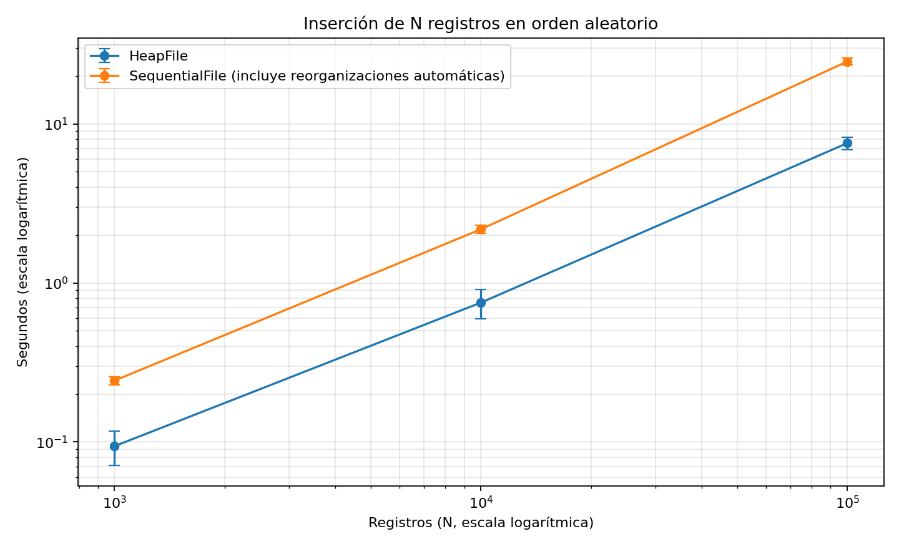

| N | Heap File (por registro) | Sequential File (por registro) | Secuencial / Heap | Reorganizaciones automáticas |
| ---: | ---: | ---: | ---: | ---: |
| 1.000 | 168,3 µs | 359,7 µs | 2,1× | 4 |
| 10.000 | 122,5 µs | 343,0 µs | 2,8× | 13 |
| 100.000 | 115,5 µs | 363,3 µs | 3,1× | 31 |

* **Heap File, O(1)**: inserta en la primera página con espacio (conjunto `free_pages` en memoria). El costo por registro es constante; el valor de 1.000 incluye el calentamiento inicial (creación del archivo y cachés frías).
* **Sequential File, O(log N) + reorganizaciones amortizadas**: cada inserción hace una búsqueda binaria de página y de slot y desplaza el directorio de slots; cuando `aux` supera su límite se reorganiza. Las reorganizaciones crecen de forma geométrica (cada una deja un 10% libre por página), así que su costo amortizado por inserción es constante: el costo total de 100.000 inserciones fue **36 s**, frente a **1.459 s** de la versión original (40 veces menos).

#### Tiempo de búsqueda por clave primaria
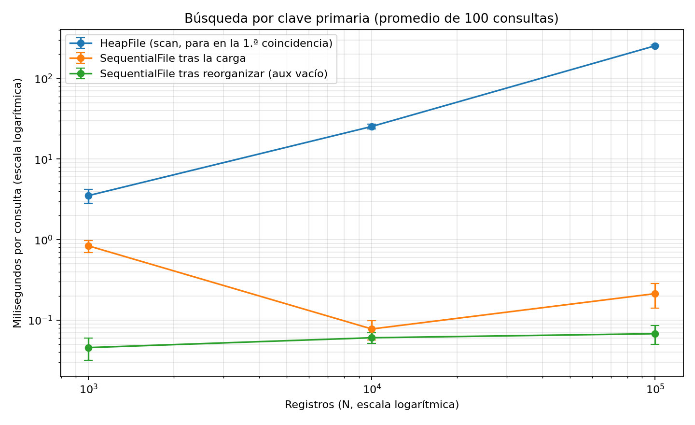

Promedio por consulta (100 claves existentes):

| N | Heap File | Secuencial tras la carga | Secuencial tras reorganizar |
| ---: | ---: | ---: | ---: |
| 1.000 | 4,578 ms | 0,124 ms | 0,120 ms |
| 10.000 | 41,513 ms | 0,105 ms | 0,082 ms |
| 100.000 | 365,726 ms | 0,120 ms | 0,115 ms |

* **Heap, O(N)**: no tiene orden y recorre las páginas hasta encontrar la clave (aun deteniéndose en la primera coincidencia); su tiempo crece unas 9 veces cuando N crece 10 veces.
* **Secuencial, O(log N)**: búsqueda binaria sobre los separadores de página (en memoria) y luego dentro de la página. Las claves que están en `aux` se ubican con un índice en memoria del área de desborde, por lo que la búsqueda no depende de cuán lleno quedó `aux`: el tiempo es prácticamente constante entre 1.000 y 100.000 registros y en 100.000 es **unas 3.000 veces más rápido** que el Heap.

#### Espacio en disco
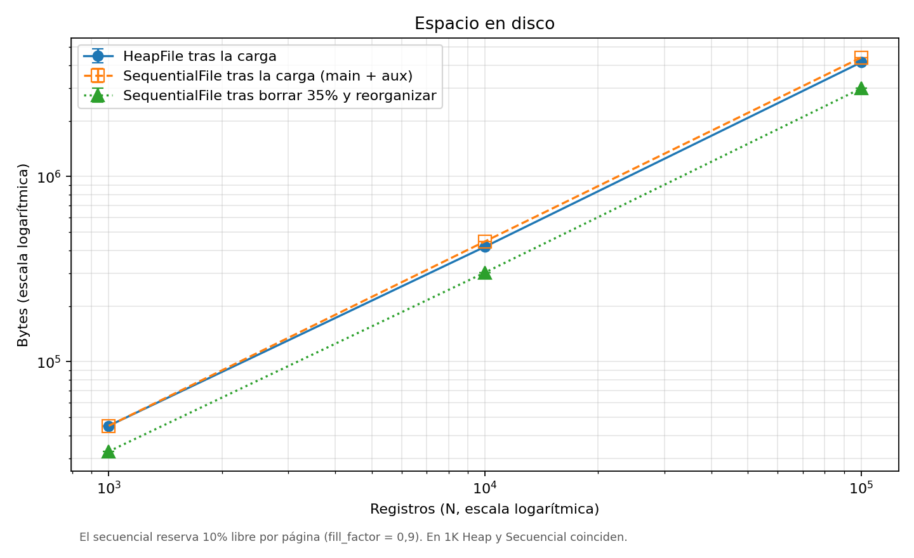

| N | Heap File | Secuencial tras la carga | Secuencial tras borrar 35% y reorganizar |
| ---: | ---: | ---: | ---: |
| 1.000 | 45.056 B | 45.056 B | 32.768 B |
| 10.000 | 417.792 B | 446.464 B (+6,9%) | 303.104 B |
| 100.000 | 4.141.056 B | 4.395.008 B (+6,1%) | 2.994.176 B |

La gráfica incluye el estado del secuencial tras borrar el 35% y reorganizar. Ambos crecen O(N). El Heap llena cada página al 100%; el secuencial reconstruye `main` con `fill_factor = 0,9` (10% libre por página para absorber inserciones) y mantiene algunas páginas en `aux`, de ahí un ~6% adicional. En 1.000 registros las inserciones posteriores a la última reorganización volvieron a llenar las páginas.

#### Proceso de reorganización
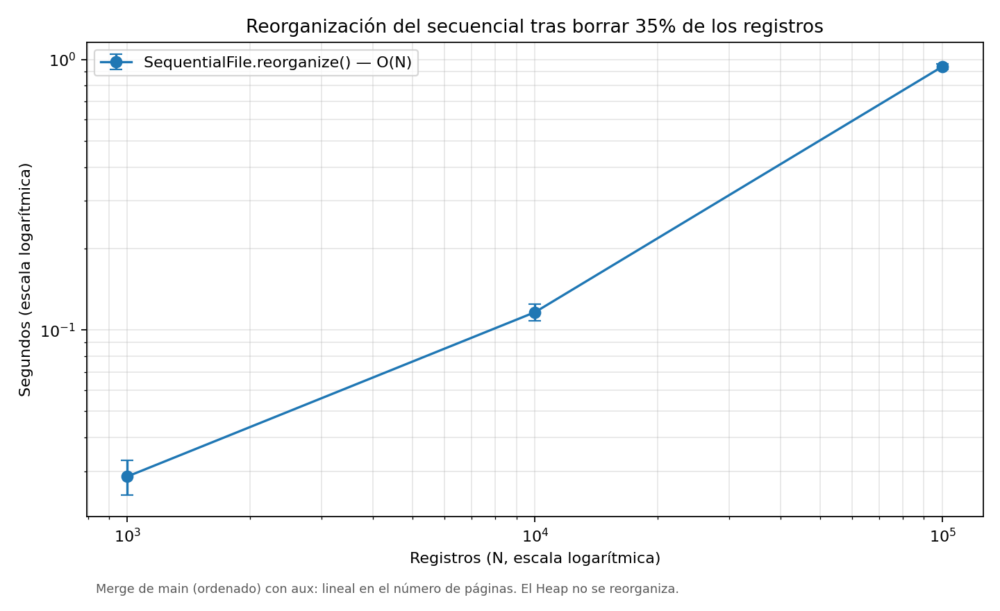

Tras borrar el **35%** de los registros (no cronometrado), `needs_reorganization()` se activa porque el desperdicio supera el **30%**. `reorganize()` tardó **0,049 s**, **0,112 s** y **1,143 s** para 1.000, 10.000 y 100.000 registros: es **O(N)** (pendiente 1,01 entre 10.000 y 100.000) más un costo fijo de crear el archivo nuevo y sincronizarlo (`fsync`), que domina con 1.000 registros. `main` ya está ordenado, así que se recorre una sola vez y se combina (*merge*) con `aux` ordenado. El archivo resultante ocupa un 32% menos que tras la carga. El Heap no necesita reorganizarse porque reutiliza los slots borrados.

#### Resumen y conclusiones de almacenamiento

| Técnica | Ventajas | Desventajas | Escenario recomendado |
| :--- | :--- | :--- | :--- |
| **Heap File** | Inserción O(1), la más rápida (~115 µs por registro, 3,1× menos que el secuencial); RIDs estables; reutiliza slots borrados sin mantenimiento. | Búsqueda por clave O(N): 366 ms por consulta en 100K sin índice; no conserva orden. | Cargas con alta tasa de escritura, o tablas que siempre se consultan mediante un índice secundario. |
| **Sequential File** | Búsqueda por clave y por rango O(log N): ~0,1 ms en 100K, unas 3.000× más rápida que el heap; datos físicamente ordenados; desde SQL el optimizador usa esa búsqueda binaria. | Inserción ~3× más lenta (búsqueda binaria + reorganizaciones amortizadas); RIDs inestables; ~6% más de espacio por el `fill_factor`. | Tablas de lectura predominante con consultas por clave primaria o por rango. |

### 3.3 Comparación de Índices: B+ Agrupado vs B+ No Agrupado vs Hash Dinámico

**Configuración.** Cada estructura usa nodos que llenan una página de 4096 B:
* B+ agrupado: **M = 92**, porque cada entrada de hoja guarda clave + registro de 36 B.
* B+ no agrupado: **M = 254**, porque cada entrada guarda clave + RID de 8 B.
* Hash: buckets de **254 entradas**.

**Todas las consultas devuelven registros completos.** El agrupado los tiene en sus hojas; el no agrupado y el hash leen cada RID de un `HeapFile` real. Así se compara el costo real de responder una consulta.

#### Tiempo de construcción
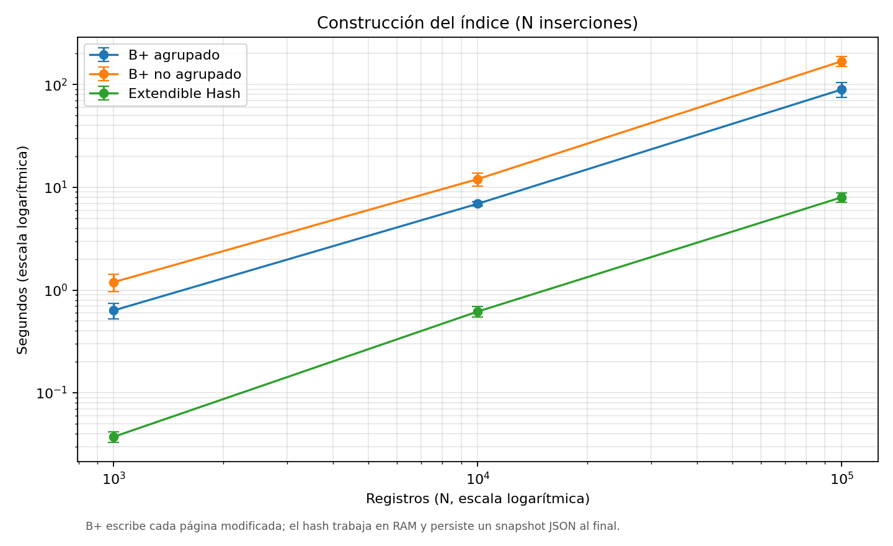

| N | B+ agrupado (por inserción) | B+ no agrupado (por inserción) | Extendible Hash (por inserción) | Snapshot del hash (una vez) |
| ---: | ---: | ---: | ---: | ---: |
| 1.000 | 388 µs | 544 µs | 26,1 µs | 0,009 s |
| 10.000 | 446 µs | 775 µs | 29,1 µs | 0,052 s |
| 100.000 | 501 µs | 800 µs | 38,7 µs | 0,575 s |

* **B+, O(log N) por inserción**: el costo por inserción casi no cambia con N porque la altura del árbol crece muy lento (2 a 3 niveles con estos M). Construir 100.000 entradas tomó 50 s (agrupado) y 80 s (no agrupado); con la versión original del B+ tomaba 698 s y 443 s.
* El no agrupado es más lento por inserción que el agrupado aunque sus entradas son más chicas: con M = 254 cada escritura de nodo serializa casi el triple de entradas que con M = 92.
* **Hash, O(1) amortizado por inserción**: entre 13 y 21 veces más barato que el B+ en 100K, porque trabaja en RAM sin escribir páginas. Persistirlo es una operación aparte y **O(N)**: el snapshot JSON completo tardó 0,009 s, 0,052 s y 0,575 s.

#### Búsqueda por igualdad
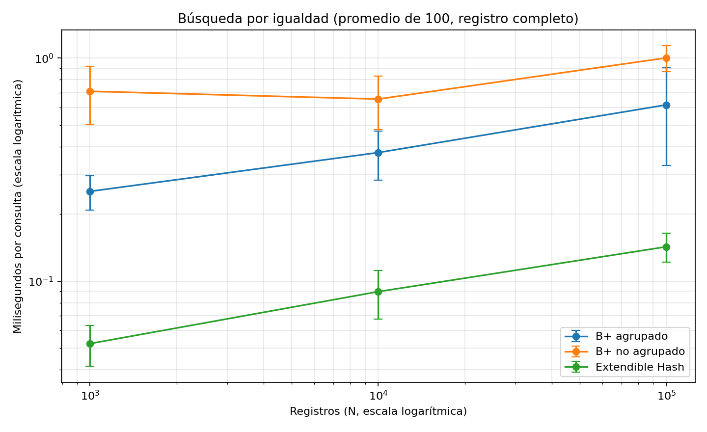

Tiempo por consulta (1.000 claves al azar), registro completo:

| N | B+ agrupado | B+ no agrupado | Extendible Hash |
| ---: | ---: | ---: | ---: |
| 1.000 | 0,150 ms | 0,463 ms | 0,038 ms |
| 10.000 | 0,250 ms | 0,437 ms | 0,040 ms |
| 100.000 | 0,228 ms | 0,495 ms | 0,068 ms |

* **Hash, O(1)**: calcula el bucket (BLAKE2b) en RAM y hace una sola lectura del heap; es el más rápido.
* **B+ agrupado, O(log N)**: baja la altura del árbol y encuentra el registro en la hoja.
* **B+ no agrupado, O(log N) + 1 lectura**: baja el árbol y además lee una página del heap; por eso es entre 1,7 y 3 veces más lento que el agrupado.
* **El escalón del log N**: el costo de un B+ depende de su altura, que solo cambia cuando el árbol suma un nivel. El agrupado (M = 92) pasa de 2 a 3 niveles entre 1.000 y 10.000 registros (17 → 161 nodos): por eso su curva sube en ese tramo y queda plana hasta 100.000 (1.585 nodos, siguen siendo 3 niveles). El no agrupado (M = 254) mantiene 2 niveles hasta 10.000 (64 nodos) y pasa a 3 en 100.000 (539 nodos), donde sube levemente. El hash no tiene niveles y queda plano dentro de la variación medida.

#### Búsqueda por rango
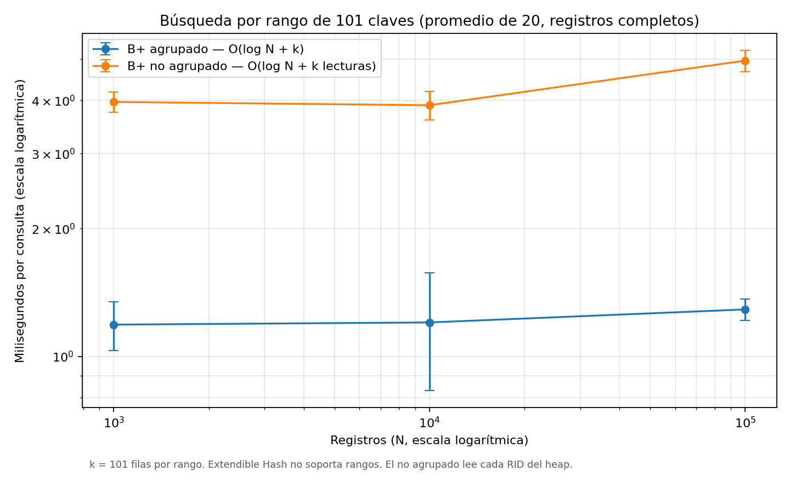

Tiempo por consulta en 200 rangos `[k, k+100]` (k = 101 registros; todos devuelven exactamente 101 filas):

| N | B+ agrupado | B+ no agrupado |
| ---: | ---: | ---: |
| 1.000 | 0,507 ms | 1,615 ms |
| 10.000 | 0,585 ms | 1,810 ms |
| 100.000 | 0,646 ms | 2,485 ms |

El costo es **O(log N + k)**: con k = 101 fijo, el término log N aporta como mucho un nivel más del árbol frente a 101 registros leídos, así que las dos curvas suben muy poco (pendientes entre +0,04 y +0,14). En el **agrupado** los 101 registros están contiguos en 1 o 2 hojas; el **no agrupado** recorre sus hojas pero debe leer cada uno de los 101 RIDs en una página distinta del heap (los datos se insertaron en orden aleatorio), por eso el agrupado es **entre 3 y 4 veces más rápido**. En el no agrupado, el tramo 10.000 → 100.000 sube algo más porque el árbol pasa a 3 niveles y el heap crece a 4 MB, con lecturas más dispersas. Esta medición se repitió aparte, con el cargador conectado y una pasada de calentamiento descartada: en la corrida general, una repetición en 10.000 tuvo interferencia (16 ms por consulta frente a ~2 ms en las otras dos). El **Extendible Hash no soporta rangos**: la función hash dispersa claves consecutivas en buckets distintos.

#### Ordenamiento (ORDER BY)
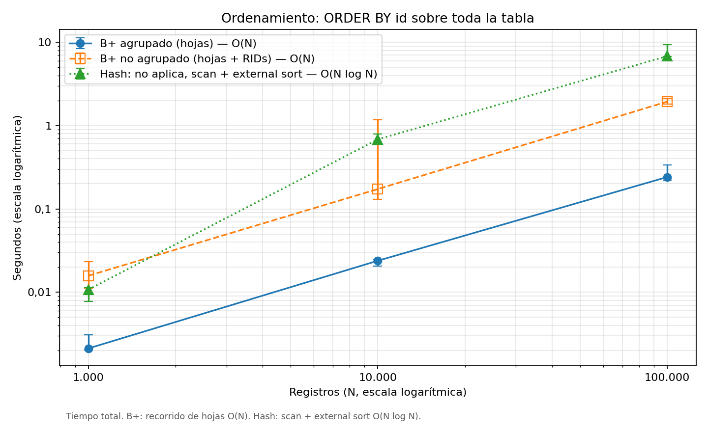

`ORDER BY id` sobre toda la tabla (tiempo total):

| N | B+ agrupado | B+ no agrupado | Extendible Hash |
| ---: | ---: | ---: | ---: |
| 1.000 | 0,002 s | 0,016 s | 0,011 s |
| 10.000 | 0,024 s | 0,173 s | 0,684 s |
| 100.000 | 0,241 s | 1,939 s | 6,82 s |

* El agrupado recorre sus hojas encadenadas, que ya están ordenadas: **O(N)**.
* El no agrupado obtiene el orden de sus hojas, pero hace una lectura aleatoria del heap por cada registro: también **O(N)**, pero 8 veces más lento que el agrupado.
* El hash no aporta orden, así que el motor recurre a `scan` del heap + *external sort* k-way, **O(N log N)**: 28 veces más lento que el agrupado. Con 1.000 registros la entrada cabe en memoria y se ordena sin escribir runs; desde 10.000 el *external sort* genera runs en disco y los mezcla, por eso ese primer tramo es más empinado.

#### Espacio en disco y memoria
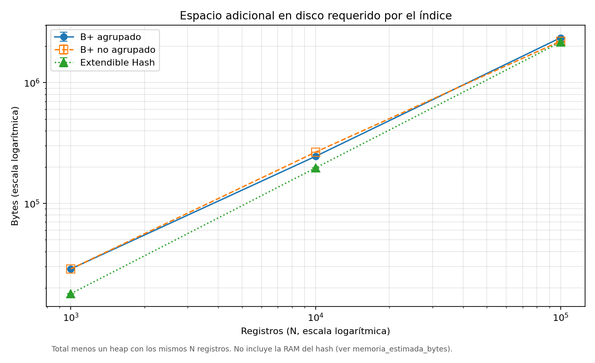

Espacio **adicional en disco** que requiere cada índice (el espacio total de tabla + índice menos el de un heap con los mismos N registros, que en 100K ocupa 4.141.056 B):

| N | B+ agrupado | B+ no agrupado | Extendible Hash (disco) | Extendible Hash (RAM) |
| ---: | ---: | ---: | ---: | ---: |
| 1.000 | 28.672 B | 28.672 B | 17.879 B | 0,24 MB |
| 10.000 | 245.760 B | 266.240 B | 197.078 B | 2,38 MB |
| 100.000 | 2.355.200 B | 2.211.840 B | 2.168.979 B | 23,8 MB |

* Los tres crecen **O(N)** (pendiente ≈ 1 en la gráfica).
* **B+ agrupado**: un solo archivo de 1.585 nodos; ocupa 2,36 MB más que el heap porque sus hojas quedan llenas en promedio al ~69% tras los splits.
* **B+ no agrupado**: 539 nodos de (clave, RID) además del heap.
* **Extendible Hash**: snapshot JSON de 2,17 MB además del heap; en ejecución ocupa **23,8 MB de RAM** (directorio de 512 entradas, 512 buckets, factor de carga 0,77), porque vive completo en memoria. Esa RAM no aparece en la gráfica, que mide solo disco: el hash es el que menos disco adicional usa, pero no el más liviano en total.

Como complemento, el espacio total (tabla + índice). Las tres curvas quedan casi superpuestas porque el heap domina el total; por eso la comparación entre índices se hace con el espacio adicional.

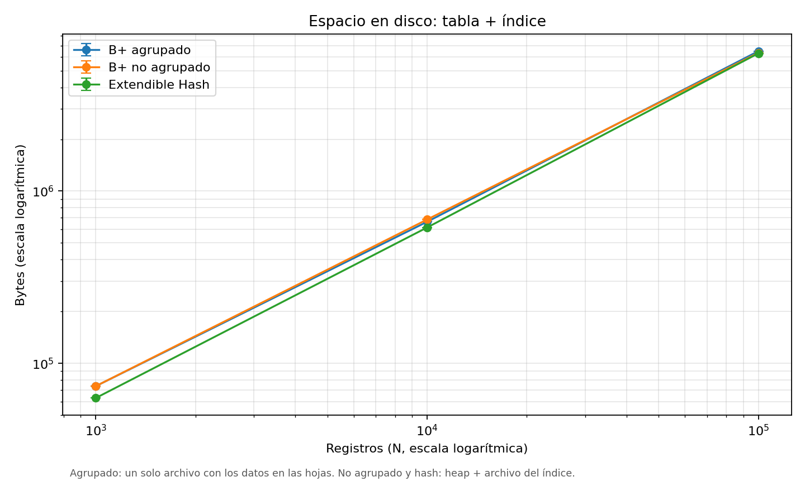

#### Inserciones y eliminaciones frecuentes
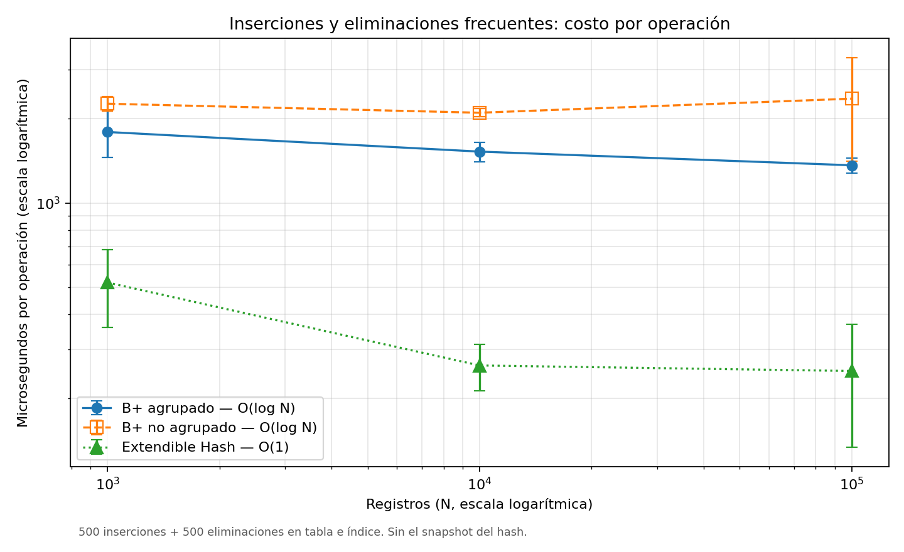

500 registros existentes elegidos al azar: cada uno se elimina y se vuelve a insertar, en tabla e índice (1.000 operaciones). Costo por operación:

| N | B+ agrupado | B+ no agrupado | Extendible Hash |
| ---: | ---: | ---: | ---: |
| 1.000 | 504 µs | 959 µs | 135 µs |
| 10.000 | 620 µs | 945 µs | 116 µs |
| 100.000 | 630 µs | 1.050 µs | 133 µs |

* **B+, O(log N) por operación**: el costo sigue a la altura del árbol, con el mismo escalón que en igualdad (el agrupado sube entre 1.000 y 10.000; el no agrupado, entre 10.000 y 100.000). Sube poco porque la mayor parte del costo es reescribir la hoja (en el agrupado, ~66 registros completos), que no depende de N. Los splits, redistribuciones y fusiones actualizan solo los separadores afectados. En una versión anterior del benchmark las claves nuevas eran siempre mayores que todas las existentes, así que todas las operaciones caían en la última hoja y el costo dependía de cuán llena quedaba esa hoja, no de N; ahora las claves se reparten por todo el árbol. Con la versión original, que recalculaba los separadores de todo el camino al eliminar, las mismas operaciones costaban entre 14 y 24 ms cada una en 100K.
* **Hash, O(1) por operación**: splits y merges locales en RAM; la curva queda plana. El costo incluye además insertar y borrar la fila en el heap. La persistencia del snapshot, O(N), se mide aparte (ver construcción).

#### Resumen y conclusiones de índices

| Técnica | Ventajas | Desventajas | Escenario recomendado |
| :--- | :--- | :--- | :--- |
| **B+ Agrupado** | El mejor en rangos (3 a 4× frente al no agrupado) y en ORDER BY (8×); igualdad O(log N) sin I/O adicional; actualizaciones O(log N). | Solo uno por tabla (define el orden físico); splits mueven registros completos; ~57% más espacio que un heap. | Clave primaria de tablas con consultas de rango, ordenamientos o recorridos por clave (`CREATE TABLE ... USING BTREE`). |
| **B+ No Agrupado** | Rangos y orden sobre cualquier columna; permite varios por tabla; claves duplicadas. | Una lectura aleatoria del heap por registro: 3 a 4× más lento que el agrupado en rangos y 8× en ORDER BY. | Índices secundarios sobre columnas con filtros de rango selectivos (pocos registros por consulta). |
| **Extendible Hash** | La igualdad más rápida (0,07 ms en 100K) y las actualizaciones más baratas, O(1); construcción 13 a 21× más barata por inserción. | No soporta rangos ni orden; reside en RAM (23,8 MB para 100K) y su persistencia es un snapshot completo O(N). | Búsquedas exactas y joins por igualdad sobre claves que no se consultan por rango. |

### 3.4 Validación: complejidad teórica vs medida

`benchmarks/complexity.py` calcula, para cada curva, la pendiente en escala log-log entre tamaños consecutivos: `pendiente = log(t₂/t₁) / log(N₂/N₁)`. Un costo constante o logarítmico da una pendiente cercana a 0 y uno lineal, cercana a 1.

**Criterio (definido por el equipo).** Se considera que una curva coincide si su pendiente en el tramo 10.000 → 100.000 cae en estos rangos: entre −0,35 y +0,35 para O(1), O(log N) y O(log N + k); entre 0,65 y 1,35 para O(N); y entre 0,85 y 1,5 para O(N log N). Se usa el último tramo porque la complejidad es asintótica y con 1.000 registros pesan los costos fijos (abrir archivos, `fsync`, cachés frías). La tabla muestra igualmente los dos tramos.

| Estructura | Medición | Teoría | Pendiente 1K→10K / 10K→100K | ¿Coincide? |
| :--- | :--- | :---: | :---: | :---: |
| HeapFile | Inserción (por registro) | O(1) | -0,14 / -0,03 | Sí |
| SequentialFile | Inserción (por registro) | O(log N) | -0,02 / +0,02 | Sí |
| HeapFile | Búsqueda por PK (por consulta) | O(N) | +0,96 / +0,94 | Sí |
| SequentialFile | Búsqueda por PK tras la carga | O(log N) | -0,07 / +0,06 | Sí |
| SequentialFile | Búsqueda por PK tras reorganizar | O(log N) | -0,17 / +0,15 | Sí |
| HeapFile | Espacio en disco | O(N) | +0,97 / +1,00 | Sí |
| SequentialFile | Espacio en disco | O(N) | +1,00 / +0,99 | Sí |
| SequentialFile | Reorganización | O(N) | +0,36 / +1,01 | Sí |
| B+ agrupado | Construcción (por inserción) | O(log N) | +0,06 / +0,05 | Sí |
| B+ no agrupado | Construcción (por inserción) | O(log N) | +0,15 / +0,01 | Sí |
| Extendible Hash | Construcción (por inserción) | O(1) | +0,05 / +0,12 | Sí |
| Extendible Hash | Snapshot JSON del hash | O(N) | +0,77 / +1,04 | Sí |
| B+ agrupado | Igualdad (por consulta) | O(log N) | +0,22 / -0,04 | Sí |
| B+ no agrupado | Igualdad (por consulta) | O(log N) | -0,03 / +0,05 | Sí |
| Extendible Hash | Igualdad (por consulta) | O(1) | +0,03 / +0,23 | Sí |
| B+ agrupado | Rango de 101 claves (por consulta) | O(log N + k) | +0,06 / +0,04 | Sí |
| B+ no agrupado | Rango de 101 claves (por consulta) | O(log N + k) | +0,05 / +0,14 | Sí |
| B+ agrupado | ORDER BY tabla completa | O(N) | +1,05 / +1,00 | Sí |
| B+ no agrupado | ORDER BY tabla completa | O(N) | +1,04 / +1,05 | Sí |
| Extendible Hash | ORDER BY (scan + external sort) | O(N log N) | +1,80 / +1,00 | Sí |
| B+ agrupado | Espacio adicional | O(N) | +0,93 / +0,98 | Sí |
| B+ no agrupado | Espacio adicional | O(N) | +0,97 / +0,92 | Sí |
| Extendible Hash | Espacio adicional | O(N) | +1,04 / +1,04 | Sí |
| B+ agrupado | Inserción/eliminación (por operación) | O(log N) | +0,09 / +0,01 | Sí |
| B+ no agrupado | Inserción/eliminación (por operación) | O(log N) | -0,01 / +0,05 | Sí |
| Extendible Hash | Inserción/eliminación (por operación) | O(1) | -0,07 / +0,06 | Sí |

Las **26 curvas** coinciden con la teoría en el tramo 10.000 → 100.000. En el tramo 1.000 → 10.000 hay dos que quedarían fuera de rango:
* **Reorganización (0,36)**: con 1.000 registros domina el costo fijo de crear y sincronizar el archivo nuevo (0,049 s); con N grande la pendiente es 1,01.
* **ORDER BY con hash (1,80)**: con 1.000 registros la entrada cabe en el buffer y se ordena en memoria; desde 10.000 el *external sort* escribe y mezcla runs en disco. En el último tramo, donde ambos tamaños usan el algoritmo externo, la pendiente es 1,00.

**Límites de esta validación.** Con tres tamaños de dataset la prueba es indicativa, no una demostración:
* No permite distinguir O(1) de O(log N): entre 1.000 y 100.000 registros, log N crece de ~10 a ~17, una diferencia menor que la variación entre corridas.
* Tampoco distingue O(N) de O(N log N): el ORDER BY con hash (+1,00 en el último tramo) también sería compatible con O(N). Su complejidad O(N log N) se sostiene por el algoritmo (*external sort*), no por la medición.

### 3.5 Conclusión general de la Parte 1
No existe una estructura óptima para todo: cada una equilibra de forma distinta el costo de escritura, la latencia de lectura y el consumo de recursos, y las mediciones son coherentes con la complejidad teórica de cada operación.
* Para **alta tasa de escritura con consultas de punto exacto**, la mejor combinación es **Heap File + Extendible Hash**: inserción O(1) (~115 µs) y búsqueda O(1) (~0,1 ms), a cambio de mantener el índice en RAM. Desde SQL, los índices se mantienen fila por fila en cada INSERT/DELETE.
* Para **consultas por rango u ordenamiento sobre la clave primaria**, conviene un **B+ agrupado**, o un **Sequential File** si la tabla se lee mucho más de lo que se escribe: su búsqueda binaria supera al heap por más de tres órdenes de magnitud a cambio de insertar ~3 veces más lento.
* El **B+ no agrupado** se justifica para columnas secundarias con filtros selectivos; en rangos grandes o en ORDER BY de toda la tabla, sus lecturas aleatorias al heap lo vuelven varias veces más lento que el agrupado.

## Entrega parcial: Base de Datos Espacial (Parte 2)

### 4. Diseño e implementación

#### 4.1 Arquitectura de la Parte 2
La Parte 2 se integra en el motor existente, sin un subsistema aparte:

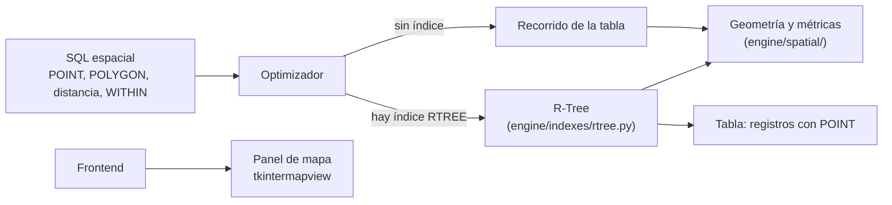

- **Tipo `POINT`:** es un tipo de columna más del registro.
- **R-Tree:** es un índice secundario más del catálogo. Se mantiene en cada INSERT y DELETE, y en el ROLLBACK de las transacciones, igual que el hash y el B+.
- **Optimizador:** reconoce los predicados espaciales y elige el R-Tree cuando existe. Sin índice, el mismo SQL se resuelve recorriendo la tabla.
- **Frontend:** agrega el panel de mapa.
- **Comparación experimental:** usa PostgreSQL + PostGIS en Docker (`postgis/`).

#### 4.2 Dominio de datos espaciales
- **Puntos:** ubicaciones en grados decimales, `POINT(lat, lon)`, con latitud entre −90 y 90 y longitud entre −180 y 180.
- **Polígonos:** anillos de vértices `(lat, lon)`, con agujeros opcionales. Se cargan desde GeoJSON (`Polygon`, `MultiPolygon`, `Feature` y `FeatureCollection`), que guarda `[lon, lat]`.
- **Dataset de los experimentos** (`benchmarks/generate_spatial_datasets.py`, semilla 42): comercios sintéticos en Lima Metropolitana, dentro del rectángulo lat ∈ [−12,30; −11,75], lon ∈ [−77,20; −76,80].
  - Cada comercio tiene `id`, `nombre` y `categoria`, repartida en partes iguales entre tienda, restaurante, gasolinera, farmacia y banco.
  - El 78% se agrupa alrededor de cuatro zonas comerciales (Cercado, Miraflores, Los Olivos y La Molina), con una dispersión de ~2 km; el resto se reparte de forma uniforme.
  - Esa mezcla de zonas densas y afueras casi vacías es la que hace que la poda espacial importe.
- **Consultas:** 100 centros uniformes en el mismo rectángulo, comunes a todas las técnicas.
- **Distritos:** `datasets/spatial/distritos_sinteticos_lima.geojson` trae dos polígonos de prueba ("Centro" y "Sur"). No son límites administrativos reales; sirven para probar la carga de GeoJSON y las consultas `WITHIN`.
- **Carga en el motor y en PostGIS:** el generador también escribe el SQL para el motor (`cargar_motor_N.sql`) y el CSV en orden lon, lat para PostGIS.

#### 4.3 Geometría y métricas de distancia
- **Coordenadas:** `POINT(lat, lon)` en grados, como en el enunciado. PostGIS y GeoJSON usan el orden `(lon, lat)`, así que el cargador de GeoJSON y el cliente de PostGIS invierten el orden.
- **`Point` y `MBR`** (`engine/spatial/geometry.py`): validan rangos y valores finitos. El `MBR` calcula área, semiperímetro, unión, *enlargement*, intersección y área de solapamiento (*overlap*). El tipo `POINT` ocupa 16 bytes en el registro (dos `double`).
- **Las dos métricas devuelven metros** (`engine/spatial/distance.py`), así `distancia(...) < 5000` significa 5 km con cualquiera:
  - **Haversine:** gran círculo sobre una esfera de radio 6.371.008,8 m. Entre Lima y Cusco da 574,6 km.
  - **Euclidiana:** trata (lat, lon) como plano y convierte grados a metros con un factor fijo (111.195 m/°). Es exacta norte-sur y sobreestima este-oeste por 1/cos(lat): +2,2% en Lima, +41% a 45° de latitud.
- **MINDIST punto-MBR:** cota inferior de la distancia a cualquier punto del rectángulo, que usa el R-Tree para podar.
  - En la Euclidiana se acota cada coordenada.
  - En la Haversine se mide sobre el meridiano del punto, o sobre el del borde más próximo (considerando el antimeridiano).
- **Radio → MBR:** el filtro grueso usa un rectángulo que contiene todo el círculo, con la longitud ensanchada según la latitud y la franja completa si toca un polo o el antimeridiano.

#### 4.4 R-Tree en disco
`engine/indexes/rtree.py` implementa el R-Tree de Guttman:
- **Nodos y capacidad:** un nodo por página de 4 KB, con M = 177 entradas por hoja (punto + RID) y M = 113 por nodo interno (MBR + página del hijo); el mínimo es m = ⌈0,4·M⌉.
- **Inserción:** ChooseLeaf baja por el hijo que menos crece. Al desbordarse, un nodo se divide con el **split cuadrático**: como semillas toma el par que más área desperdicia junto y reparte el resto según qué grupo crece menos. Si las áreas empatan en 0 (puntos alineados), desempata por semiperímetro.
- **Eliminación:** CondenseTree reinserta las entradas de los nodos que quedan con menos de m. Las páginas liberadas se reutilizan.
- **Persistencia:** el árbol persiste en disco y se reabre. Los contadores de cada consulta (nodos, hojas, candidatos, refinamientos) alimentan EXPLAIN ANALYZE y el benchmark.

#### 4.5 Consultas espaciales
- **Rango por radio:** filtro por el MBR del círculo y refinamiento con la distancia exacta (`<=` radio).
- **k-NN:** búsqueda *best-first* con una cola de prioridad de nodos ordenada por MINDIST y un heap con los k mejores puntos. Se detiene cuando el nodo más prometedor ya está más lejos que el k-ésimo vecino. Los empates se resuelven por RID.
- **Polígono:** filtro por el MBR del polígono y refinamiento con *ray casting*. Incluye el borde y admite agujeros y polígonos cóncavos; los distritos se leen de GeoJSON (`Polygon`, `MultiPolygon`, `Feature`, `FeatureCollection`).

#### 4.6 SQL espacial
Sintaxis soportada:
- columna `POINT` y literales `POINT(lat, lon)` y `POLYGON((lat, lon), ...)`;
- `distancia(col, POINT(...))` en `WHERE` (rango) y en `ORDER BY ... LIMIT k` (k-NN);
- `WITHIN(col, POLYGON(...))`;
- métrica con `USING HAVERSINE | EUCLIDEAN` o con un tercer argumento de `distancia`;
- `CREATE INDEX ... USING RTREE`.

El optimizador usa el R-Tree cuando hay uno vigente y el predicado permite poda; si no, recorre la tabla con el mismo resultado. Los demás filtros del `WHERE` se aplican después. Si un k-NN tiene filtros adicionales, el ejecutor amplía el k pedido al índice hasta reunir k filas que los cumplan. El índice se mantiene fila por fila en el Heap File y se reconstruye al final de la sentencia en el secuencial y el B+ agrupado.

#### 4.7 Mapa
La pestaña **Mapa** del frontend integra un mapa nativo de Tkinter (`tkintermapview`):
- Dibuja los puntos de la tabla, resalta los del resultado y muestra el radio o el polígono de la consulta. El clic derecho > **Insertar POINT aquí** escribe `POINT(lat, lon)` en el editor.
- Los puntos de cada tabla se leen una vez y se cachean hasta que una sentencia pueda modificarlos. Así el mapa no agrega un recorrido de la tabla a cada consulta: con 20.000 filas, un k-NN tarda ~5 ms en lugar de ~360 ms.
- El navegador redibuja solo cuando hay una consulta nueva, conservando el zoom del usuario.

#### 4.8 Validación de corrección
- **Consultas del R-Tree:** rango, k-NN y polígono se compararon con fuerza bruta en 30 semillas (distintos M, puntos repetidos, k = 0 y k > N, ambas métricas): 0 diferencias.
- **Punto en polígono:** coincide con la implementación de matplotlib en 60.000 puntos sobre polígonos cóncavos aleatorios.
- **SQL espacial:** se ejecutó el mismo conjunto de consultas en los tres almacenamientos, con y sin índice RTREE, y se comparó con Python: 0 diferencias. Incluye:
  - el borde exacto de `<` frente a `<=`;
  - filtros con AND y OR;
  - k-NN con `WHERE`, `OFFSET` y `DESC`;
  - la métrica Euclidiana, `WITHIN` y GROUP BY;
  - el mantenimiento del índice tras DELETE y ROLLBACK.
- **PostGIS:** con la distancia esférica, GiST devuelve exactamente los mismos resultados que nuestra búsqueda secuencial y que el R-Tree. Lo verifica el benchmark en cada consulta.

### 5. Comparación experimental: Secuencial vs R-Tree vs GiST

#### 5.1 Metodología
`benchmarks/bench_spatial.py`; los resultados están en `benchmarks/results/spatial_*`.

**Datos y consultas**
* **Puntos:** 1.000, 10.000 y 100.000 comercios del dataset descrito en la sección 4.2.
* **Consultas:** 100 centros, los mismos para las tres técnicas.
  * Rango con radio de 1, 5 y 10 km.
  * k-NN con k = 10, 50 y 100.

  Cada tiempo es el promedio por consulta, con 3 repeticiones por tamaño (media ± desviación estándar en las gráficas).

**Condiciones de la comparación**
* **Origen de los resultados:** las tres técnicas leen de una tabla en disco.
  * **Secuencial:** recorre un `HeapFile` y calcula la distancia de cada punto.
  * **R-Tree:** obtiene los RID del índice y lee esos registros del mismo heap.
  * **GiST:** consulta su tabla en PostgreSQL 16 + PostGIS 3.4 (Docker), con `ST_DWithin` para el rango y `ORDER BY <-> LIMIT k` para k-NN.
* **Distancia:** Haversine sobre la esfera en las tres. PostGIS mide por defecto sobre el elipsoide WGS84, que a 6 km difiere un 0,3% y cambiaría qué puntos quedan dentro del radio; por eso se usa `ST_DWithin(..., false)`. El operador `<->` ya usa la esfera.
* **Construcción:**
  * R-Tree: inserción punto por punto.
  * GiST: solo `CREATE INDEX`, con la tabla ya cargada.
  * Secuencial: no construye índice.
* **Espacio:** tamaño del archivo del R-Tree y `pg_relation_size` del índice GiST. La **memoria** del R-Tree es el pico de `tracemalloc` al construirlo, medido en una pasada aparte porque `tracemalloc` lo hace ~5 veces más lento. La memoria de GiST está en el servidor y no se mide.
* **Verificación:** fuera del cronómetro, cada resultado del R-Tree y de GiST se compara con la búsqueda secuencial: el rango por conjunto de ids y el k-NN por distancias, con 1 mm de tolerancia. Las 1.800 consultas de cada técnica coincidieron.
* **Detalle del k-NN en PostGIS:** se ordena solo por `<->`. Si se agrega otra clave de orden (`ORDER BY ubicacion <-> c, id`), PostgreSQL deja de usar el índice y recorre y ordena toda la tabla.

**Entorno:** Windows 11, Python 3.13 y PostGIS en Docker. La corrida tardó 44 minutos y las repeticiones fueron estables: con 100.000 puntos, la construcción del R-Tree tardó entre 53,3 y 53,8 s, y cada consulta secuencial entre 0,59 y 0,81 s. Una corrida anterior se descartó porque la máquina estuvo cargada durante la medición: tardó 78 minutos y una de sus repeticiones salió 6 veces más lenta que las otras.

#### 5.2 Construcción del índice
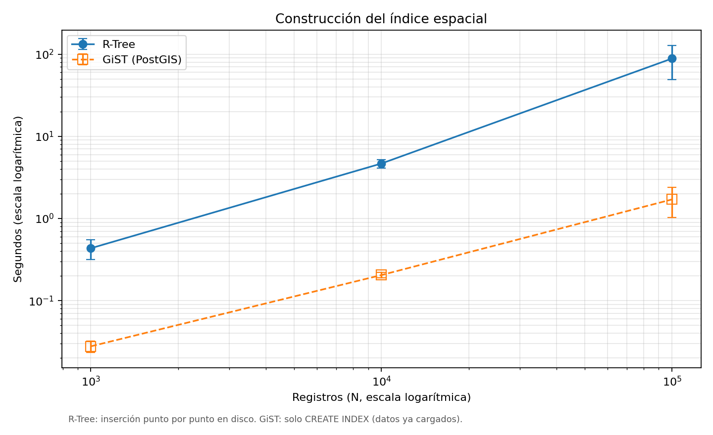

| N | R-Tree | GiST |
| ---: | ---: | ---: |
| 1.000 | 0,44 s | 0,026 s |
| 10.000 | 4,4 s | 0,23 s |
| 100.000 | 54 s | 1,3 s |

**Complejidad:** por el algoritmo, las dos construcciones son O(N log N): N inserciones de costo logarítmico.
* **R-Tree:** las pendientes log-log medidas son 1,00 y 1,09, coherentes con ese orden.
* **GiST:** sus pendientes, 0,94 y 0,75, quedan por debajo de 1 porque con N chico pesan costos fijos (`CREATE INDEX`, `ANALYZE` y la ida y vuelta al servidor). Igual que con el ORDER BY del hash (sección 3.4), ese orden se sostiene por el algoritmo, no por la medición.

**Comparación:**
* **R-Tree:** inserta punto por punto en Python y reescribe una página de 4 KB por inserción; el split cuadrático cuesta O(M²) por división.
* **GiST:** construye en C con escritura masiva. Es 17 veces más rápido con 1.000 puntos, 19 con 10.000 y 42 con 100.000; la diferencia crece con N.

Un *bulk loading* (por ejemplo STR) reduciría mucho la construcción del R-Tree; queda como mejora posible.

#### 5.3 Consulta por rango
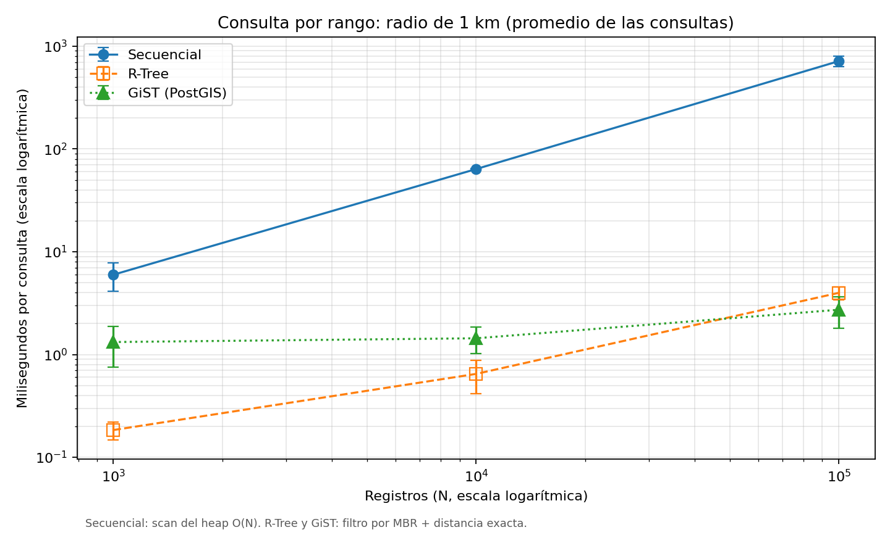
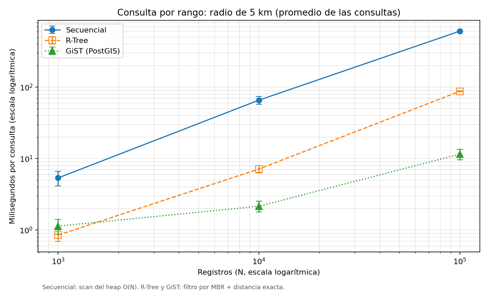
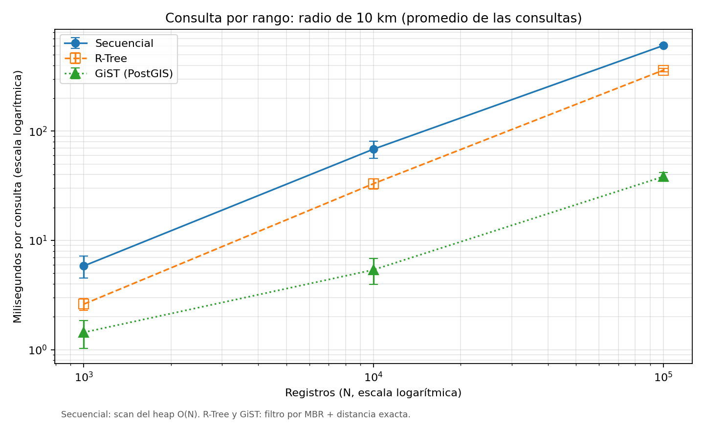

Promedio por consulta con 100.000 puntos; entre paréntesis, la cantidad media de puntos devueltos:

| Radio | Secuencial | R-Tree | GiST |
| :--- | ---: | ---: | ---: |
| 1 km (105 puntos, 0,1%) | 716 ms | 4,0 ms | 2,7 ms |
| 5 km (2.666 puntos, 2,7%) | 606 ms | 87 ms | 11,5 ms |
| 10 km (10.830 puntos, 10,8%) | 606 ms | 361 ms | 38 ms |

* **Secuencial, O(N):** recorre toda la tabla sin importar el radio. Su tiempo crece unas 10 veces por cada aumento de 10 veces en N (6 ms, 64 ms y ~0,6 s).
  * Con 100.000 puntos, el radio de 1 km sale un 18% más lento (716 frente a 606 ms) aunque el trabajo es el mismo.
  * Es la primera medición de cada repetición, así que incluye calentamiento, y además una de sus tres corridas tardó 0,81 s.
  * Está dentro de la variación de la máquina y no se repite con 1.000 ni con 10.000 puntos.
* **R-Tree, O(log N + k):** k es la cantidad de puntos devueltos.
  * Con radios selectivos es 180 veces más rápido que el secuencial (1 km).
  * La ventaja se reduce a medida que el radio cubre más tabla. Con 100.000 puntos, el filtro por MBR visita en promedio 74 de los 838 nodos (promedio de los tres radios), y luego cada resultado exige leer su registro del heap con un acceso aleatorio.
  * Con 10 km devuelve el 11% de la tabla y solo es 1,7 veces más rápido que el secuencial.
  * **Por qué la curva sube casi como el secuencial:** en las gráficas de 5 y 10 km la curva del R-Tree tiene pendiente cercana a 1 (1,10 y 1,04 en 10 km). No contradice O(log N + k): el radio es fijo y los puntos cubren la misma zona, así que k es una fracción constante de N (0,1%, 2,7% y 10,8% según el radio) y crece con N. El término k domina, y el costo por resultado es lineal en k, no en N. Con 1 km, donde k es chico, la pendiente baja a 0,55 y 0,79.
* **GiST:** sigue el mismo patrón, pero en C. Con 1.000 puntos su ventaja desaparece: cada consulta paga ~1 ms de ida y vuelta entre el cliente y el servidor, y el R-Tree resulta más rápido para 1 km (0,18 ms frente a 1,32 ms).

#### 5.4 Consulta k-NN
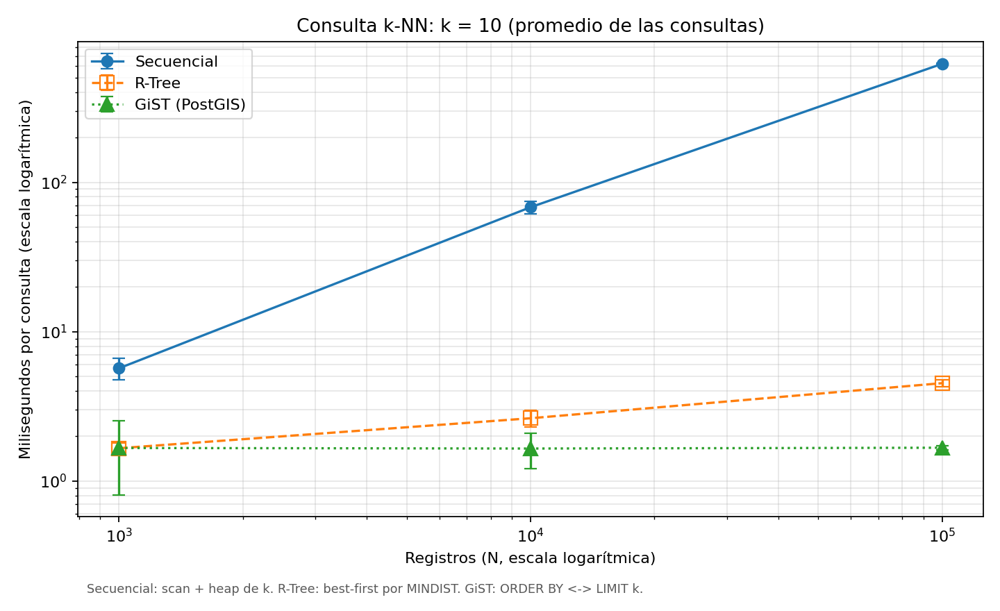
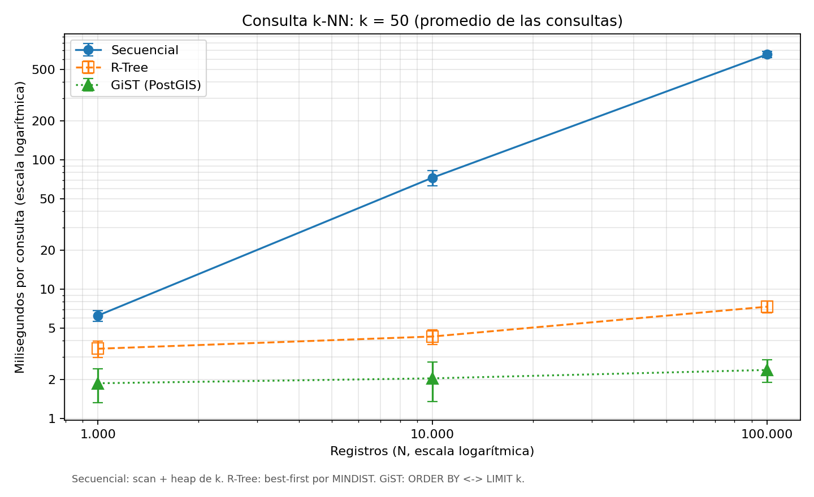
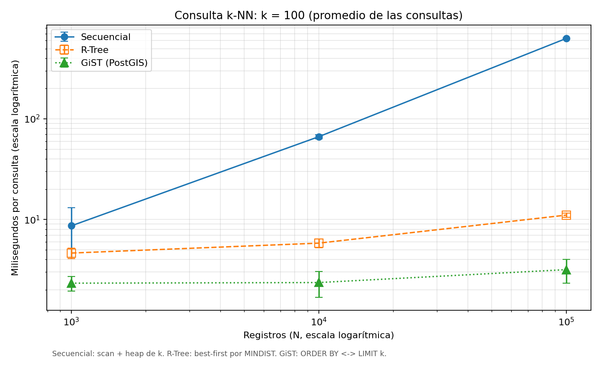

| N | k | Secuencial | R-Tree | GiST |
| ---: | ---: | ---: | ---: | ---: |
| 1.000 | 10 | 5,7 ms | 1,7 ms | 1,7 ms |
| 10.000 | 10 | 68 ms | 2,6 ms | 1,7 ms |
| 100.000 | 10 | 622 ms | 4,5 ms | 1,7 ms |
| 100.000 | 100 | 631 ms | 11,0 ms | 3,2 ms |

* **Secuencial:** recorre toda la tabla manteniendo un heap de k elementos, O(N log k).
* **R-Tree:** con 100.000 puntos, la búsqueda *best-first* por MINDIST visita en promedio solo 8,6 nodos (promedio de k = 10, 50 y 100) y se detiene apenas el nodo más prometedor queda más lejos que el k-ésimo vecino. Su tiempo apenas crece con N (de 1,7 a 4,5 ms al multiplicar N por 100) y con 100.000 puntos es 138 veces más rápido que el secuencial.
* **Un k mayor** cuesta poco más, porque los vecinos adicionales están en las mismas hojas o en las vecinas.

#### 5.5 Espacio y memoria
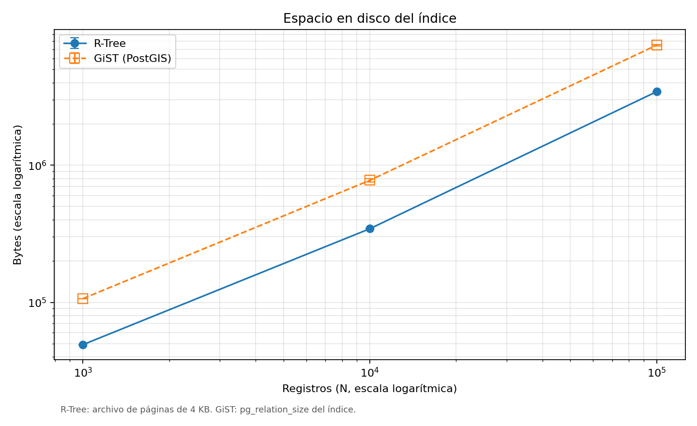

| N | R-Tree (disco) | GiST (disco) | R-Tree (pico de memoria al construir) |
| ---: | ---: | ---: | ---: |
| 1.000 | 49 KB | 107 KB | 90 KB |
| 10.000 | 344 KB | 776 KB | 63 KB |
| 100.000 | 3,4 MB | 7,5 MB | 129 KB |

* **Disco:** ambos índices crecen O(N). El R-Tree ocupa menos de la mitad que GiST:
  * cada hoja guarda solo el punto y el RID (23 bytes);
  * GiST guarda una caja por entrada más la cabecera de cada tupla del índice.
* **Memoria:** el R-Tree trabaja en disco y solo mantiene en memoria el camino de nodos que está modificando, así que su pico prácticamente no crece con N.

#### 5.6 Cuándo usar cada técnica

| Técnica | Ventajas | Desventajas | Cuándo usarla |
| :--- | :--- | :--- | :--- |
| **Búsqueda secuencial** | Sin construcción ni espacio adicional; siempre correcta; no se degrada con inserciones. | O(N) por consulta: ~0,6 s con 100.000 puntos para cualquier radio o k. | Tablas pequeñas (unos pocos miles de puntos), consultas esporádicas o que devuelven gran parte de la tabla. |
| **R-Tree (propio)** | k-NN casi independiente de N (4,5 ms con 100.000); rango selectivo 180 veces más rápido que el secuencial; índice compacto y en disco, con poca memoria. | Construcción lenta en Python (54 s para 100.000 puntos); con radios grandes el costo lo dominan las lecturas aleatorias de cada resultado. | Consultas selectivas (radios chicos, k-NN) sobre tablas medianas o grandes dentro del motor. |
| **GiST (PostGIS)** | Lo más rápido en todos los casos con N grande (implementación en C); construcción entre 17 y 42 veces más rápida (crece con N). | Requiere un servidor PostgreSQL; índice ~2 veces más grande; ~1 ms de ida y vuelta por consulta, que pesa con tablas chicas. | Producción y grandes volúmenes, cuando se dispone de PostgreSQL. |

#### 5.7 Conclusiones
* **La poda espacial funciona:** con 100.000 puntos, el R-Tree resuelve un k-NN visitando ~9 de 838 nodos y un rango de 1 km visitando una fracción de ellos. Eso explica las mejoras de dos órdenes de magnitud frente al recorrido secuencial, cuyo costo es lineal.
* **El beneficio depende de la selectividad:** mientras más puntos devuelve la consulta, más se acerca el índice al costo del recorrido. Con radios que cubren ~10% de la tabla, el R-Tree solo es 1,7 veces más rápido que el secuencial.
* **Frente a GiST:** el R-Tree sigue la misma tendencia, pero la diferencia no es constante.
  * Con 100.000 puntos va de 1,5 veces (1 km) a 9,4 veces (10 km) en rango, y de 2,7 a 3,5 veces en k-NN.
  * Crece con la cantidad de resultados, porque el R-Tree lee cada uno del heap en Python.
  * Con 1.000 puntos, en cambio, el R-Tree es más rápido en rangos chicos, porque GiST paga la ida y vuelta al servidor.
  * En construcción, la diferencia va de 17 a 42 veces y también crece con N, por Python frente a C y la construcción masiva de GiST.
  * En espacio, el R-Tree es más compacto.
* **La métrica debe ser la misma en todas las técnicas:** PostGIS usa el elipsoide por defecto, y comparar contra una distancia esférica sin ajustarlo produce resultados distintos cerca del borde del radio.

---

## Búsqueda de texto (Parte 3)

### 6. Preprocesamiento de texto

Documentos y consultas pasan por la misma función, `tokens(texto, idioma)` en `engine/text/preprocessing.py`, para generar los mismos términos. El idioma se elige entre español e inglés. Las etapas, en orden, son:

1. **Tokenización y normalización**: pasa a minúsculas y descarta la puntuación. Las siglas se unen (`O.N.U.` → `onu`), los decimales forman un solo token (`3,14` → `3.14`) y los números se conservan.
2. **Stopwords**: se eliminan comparando sin tildes.
3. **Stemming**: usa Snowball, con una caché de raíces porque el vocabulario se repite mucho.
4. **Tildes**: se quitan al final y se conserva la `ñ`. Deben quitarse después del stemming, porque Snowball usa la tilde para reconocer terminaciones: `corrió` da `corr`, pero `corrio` da `corri`.

**Stopwords.** La lista en español parte de la del laboratorio (608 términos) y conserva 476. Se quitaron 132 con contenido propio o que no aportan a una colección general: sustantivos (`trabajo`, `tiempo`, `valor`), adjetivos (`nuevo`, `mejor`), verbos con significado (`trabajar`, `usar`), verbos típicos de noticias (`afirmó`, `señaló`), números y erratas. Sigue el criterio de Manning, Raghavan y Schütze: partir de los términos frecuentes y filtrarlos a mano según su significado. La lista resultante contiene toda la de Snowball, salvo `estado` y `estados`, que se conservan como términos para no perder búsquedas como "Estados Unidos". La lista en inglés contiene la de Snowball, más `can` y `will`.

**Limitaciones conocidas.**

* Algunas stopwords tienen otro significado: `era` también es sustantivo, por lo que "era digital" solo busca `digital`.
* Sin tildes, `sería` y `seria` son la misma palabra, así que `seria` también se elimina.
* Una consulta sin tilde no siempre coincide con el documento en verbos agudos (`corrio` y `corrió`).
* Snowball no une todas las variantes: `año` y `años` tienen raíces distintas, y el inglés `ran` no se reduce a `run`.

### 7. Índice invertido con SPIMI

El índice está en `engine/indexes/spimi.py` y usa SPIMI (*Single-Pass In-Memory Indexing*), que no necesita cargar la colección completa en memoria.

**Formato en disco.** El archivo se divide en páginas de 4 KB. La página 0 es la cabecera, con el idioma, los totales y la ubicación de tres zonas contiguas:

| Zona | Contenido |
|---|---|
| Postings | Listas de `(doc_id, tf)` escritas una tras otra, ordenadas por `doc_id` |
| Diccionario | Por término, su `df` y el byte donde empieza su lista |
| Documentos | Por `doc_id`, su RID, longitud y norma, en registros de 19 bytes |

**Construcción.** Cada documento pasa por el preprocesamiento y recibe un `doc_id` creciente. Sus postings se acumulan en un hash; cuando el bloque llega a su límite (8 MiB en disco por defecto), se ordena por término y se escribe en un archivo temporal. Un documento nunca se parte entre bloques. Después, una mezcla k-way con cola de prioridad, con un buffer de lectura por bloque, une los bloques. Como los `doc_id` crecen, basta concatenar las listas de un término en orden de bloque para que sigan ordenadas. Los términos de más de 255 bytes se descartan, porque suelen ser hashes o base64, y así toda entrada cabe en una página.

**Lectura.** En la primera búsqueda se carga en memoria el primer término de cada página del diccionario. Buscar un término ubica su página con búsqueda binaria, lee esa página y lee la lista de corrido. Consultar un documento lee una sola página, porque su posición se calcula con el `doc_id`. Abrir el índice no lo reconstruye.

**Esquema de pesos.** Se usa `lnc.ltc`, el del ejemplo de la diapositiva 68 de la clase 07, que también presenta *Introduction to Information Retrieval*:

```text
Documento: w(t,d) = 1 + log10(tf)
Consulta:  w(t,q) = (1 + log10(tf)) × log10(N / df)
Norma:     norma(d) = √Σ w(t,d)²
```

El peso del documento no usa `idf`, así que su norma solo depende de él y sigue siendo exacta cuando la colección cambia. La fórmula `1 + log10(tf)` es la que usan los ejemplos resueltos de clase, y se suma 1 para que un término presente no pese 0. Para el documento `"seguro de carro, seguro de auto"`, la norma calculada es 1.92, igual que en la diapositiva.

**Ranking.** `SpimiIndex.rank_tfidf(texto, top_k)` calcula la similitud del coseno con esos pesos; `cosine_search` es su alias. `SpimiIndex.rank_bm25(texto, top_k, k1=1.2, b=0.75)` calcula Okapi BM25, con `idf = ln(1 + (N - df + 0.5) / (df + 0.5))`; `k1` controla la saturación de `tf` y `b` la normalización por longitud, y `bm25_search` es su alias. Ambos leen solo las postings de los términos de la consulta, consultan cada página de la tabla de documentos una sola vez y mantienen el top-k con un heap de tamaño `k`. En `lnc.ltc`, un término presente en todos los documentos tiene `idf` 0 y no aporta al puntaje, por lo que una consulta formada solo por él no devuelve resultados.

**Mantenimiento.** Reescribir el índice en cada cambio sería muy costoso, así que se usa un índice auxiliar. Las inserciones van a un delta en memoria y las eliminaciones a un conjunto de borrados, y ambos se registran en un log. Cada lectura combina el índice principal y el delta, y descarta lo borrado. Al abrir, el log vuelve a aplicarse; si la última escritura quedó cortada, se descarta. Cuando los cambios superan el 10 % de los documentos, con un mínimo de 1.000, se consolida en un archivo nuevo que reemplaza al anterior de forma atómica. Los `doc_id` se renumeran, por lo que el resultado equivale a construir desde cero. El log lleva la generación del índice, para ignorarlo si el proceso cae entre reemplazar el archivo y borrarlo. Un límite proporcional mantiene constante el costo amortizado por posting; con un límite fijo, el costo total sería cuadrático.

En tablas cuyos RID se mueven (secuencial y B+ agrupado), el catálogo reconstruye el índice al final de la sentencia, como con los demás índices. El índice se registra como índice de texto, para que el planificador no lo use en `WHERE columna = valor`: busca términos, no el valor exacto.

**Costos.** La mezcla cuesta `O(P log k)`, con `P` postings y `k` bloques. Buscar un término cuesta una búsqueda binaria en memoria, una página del diccionario y la lectura contigua de su lista. Rankear suma, como máximo, una lectura por página de la tabla de documentos y `O(C log k)` para el top-k, con `C` documentos candidatos.

**Validación.** Las pruebas comparan el índice con un cálculo por fuerza bruta, con bloques de distintos tamaños y tras series de inserciones y eliminaciones aleatorias, antes y después de consolidar. El archivo sale idéntico byte por byte con cualquier tamaño de bloque, y un índice consolidado coincide con uno construido desde cero, salvo la generación de la cabecera. También se comprueban los ejemplos de clase: la mezcla de `brutus` (clase 09, diapositiva 9), la intersección `Bruto AND Cesar` (clase 07, diapositiva 78) y la norma de la diapositiva 68. Los dos rankings se comparan con un cálculo por fuerza bruta con varios valores de `k`, y con un índice construido solo con los documentos vivos.

**Medición preliminar.** Con texto sintético de 40 palabras por documento y un vocabulario de 20.000 términos con frecuencias tipo Zipf:

| Documentos | Construcción | Tamaño | Lectura de una lista (mediana) |
|---:|---:|---:|---:|
| 1.000 | 2,4 s | 0,5 MB | 0,27 ms |
| 10.000 | 7,8 s | 3,2 MB | 0,26 ms |
| 100.000 | 38,8 s | 28,1 MB | 0,30 ms |

La memoria adicional de construir 20.000 documentos fue de 4,0 MB con bloques de 256 KB y de 16,5 MB con bloques de 2 MiB, porque durante la mezcla solo se retiene una entrada y un buffer de 64 KB por bloque. Estas cifras son preliminares y corresponden a otro corpus: la comparación con BM25 y GIN de la sección 9 utiliza las noticias sintéticas de #49. Sus medidas de memoria también tienen otro alcance y no deben mezclarse con esta medición adicional.

**Simplificaciones.**

* `index.df()` sigue contando los documentos borrados hasta consolidar, porque responde sin leer la lista. El ranking no usa ese valor: toma como `df` el largo de la lista sin borrados, y `N` y la longitud promedio se ajustan de inmediato, así que los puntajes son exactos antes de consolidar.
* Las postings no se comprimen, así que el índice ocupa más disco.
* No se guardan posiciones, por lo que no se pueden buscar frases exactas.
* El diccionario usa un solo nivel en memoria en vez de un B+ completo. Ocupa memoria proporcional a sus páginas, algo mínimo con 100.000 documentos.
* La mezcla abre todos los bloques a la vez, así que el número de bloques está limitado por los archivos abiertos que admite el sistema.

### 8. Extensión SQL de texto

**Tipo `TEXT`.** Un registro tiene tamaño fijo y debe caber en una página de 4 KB, así que un documento largo no cabe en un `VARCHAR`, que además ocupa su tamaño completo aunque el texto sea corto. Por eso el valor de una columna `TEXT` se guarda en un archivo aparte, `<tabla>.text`, y el registro solo conserva su posición y largo en 12 bytes. Los tres tipos de tabla lo usan sin cambios, porque esa conversión ocurre en el `Schema`. Como el B+ agrupado vuelve a serializar sus registros al reescribir un nodo, cada contenido se identifica por su hash y se guarda una sola vez. `TEXT` no puede ser clave primaria, clave de orden físico ni llave foránea, y solo admite índices SPIMI.

**Índice.** `CREATE INDEX i ON t (col) USING SPIMI [WITH (LANGUAGE = 'es' | 'en')]` indexa una columna `TEXT` o `VARCHAR`. El idioma por defecto es español. Las inserciones y eliminaciones mantienen el índice como en la sección anterior, también al hacer `ROLLBACK`.

**Consultas.** Los ejemplos del enunciado se ejecutan tal cual:

```sql
SELECT * FROM documentos WHERE MATCH(contenido, 'base de datos vectorial') USING TF_IDF LIMIT 10;

SELECT *, SCORE() AS relevancia FROM articulos
WHERE MATCH(texto, 'machine learning') USING BM25
ORDER BY relevancia DESC;
```

`MATCH` devuelve los documentos con algún término de la consulta, y `USING` es obligatorio. El planificador lo separa del `WHERE` y lo pasa al recorrido de la tabla, que llama al ranking y entrega las filas de mayor a menor puntaje. Por eso `ORDER BY relevancia DESC` no agrega un `Sort`, y un `LIMIT` sin `ORDER BY` devuelve el top-k.

Al índice solo se le piden `limit + offset` documentos si recortar no puede perder resultados. Con otro filtro, otro `ORDER BY`, `DISTINCT` o agregación se pide todo y las demás condiciones se aplican después, igual que en el k-NN espacial.

**Restricciones.** `MATCH` requiere un índice SPIMI sobre la columna y solo se admite una vez, en el `WHERE` de un `SELECT` sobre una tabla y unido con `AND`, porque en otro lugar no equivale a filtrar por el índice. `SCORE()` requiere ese `MATCH` y no se admite con agregación. `TEXT`, `SPIMI`, `MATCH`, `SCORE`, `TF_IDF` y `BM25` no son palabras reservadas, de modo que siguen siendo nombres de columna válidos.

**Plan de ejecución.** `EXPLAIN` muestra un nodo `Text Search` con el índice, la consulta, la técnica y el top-k. La estimación de filas y costo usa el `df` de cada término, sin leer las postings. `EXPLAIN ANALYZE` agrega las postings y páginas del índice leídas.

**Simplificaciones.** Eliminar una fila no libera el espacio de su texto en `<tabla>.text`, y tras reabrir la tabla un mismo texto puede guardarse de nuevo. Ninguno de los dos casos afecta los datos.

### 9. Comparación experimental de texto (Parte 3)

Se ejecutaron 27 corridas: TF-IDF/coseno, BM25 y PostgreSQL GIN + ts_rank,
en 1K, 10K y 100K documentos, con tres repeticiones. Cada corrida evaluó
las 30 consultas de #49, agrupadas en 1, 3 y 6 palabras: 810 consultas
medidas y 8.100 resultados top-10 auditados. Los documentos son noticias
sintéticas españolas con juicios por tema principal, no juicios humanos.

El [protocolo reproducible](../benchmarks/TEXT_BENCHMARK.md) describe
semillas, calentamiento, aislamiento y alcance de cada medida. Los
[resultados completos](../benchmarks/results/text/tables.md), CSV, rankings,
metadatos y planes están versionados en `benchmarks/results/text/`.
Las gráficas muestran medias y rango mínimo–máximo entre repeticiones;
los CSV incluyen desviación estándar. Se siguieron los laboratorios 09/10
y los tamaños del checklist #51.

#### 9.1 Construcción y preparación

| Técnica (100K) | Carga (s) | Índice (s) | Carga + índice (s) |
|---|---:|---:|---:|
| TF-IDF/coseno | 5,252 | 33,568 | 38,820 |
| BM25 | 5,246 | 33,710 | 38,956 |
| GIN + ts_rank | 20,415 | 2,055 | 22,470 |

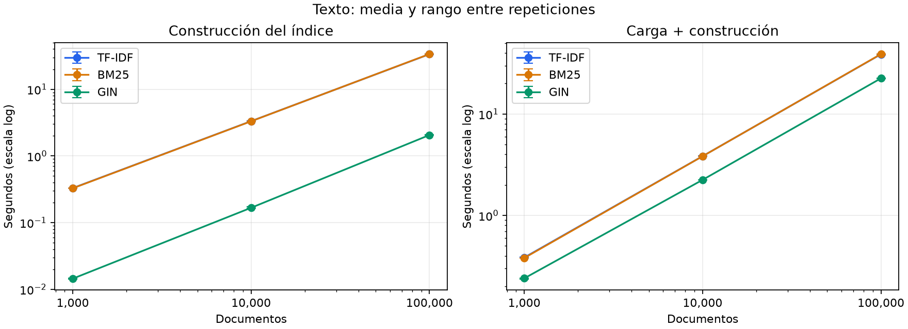

TF-IDF y BM25 construyen el mismo SPIMI; sus diferencias de tiempo son
variación experimental. PostgreSQL calcula el tsvector durante COPY, mientras
SPIMI procesa el texto durante la construcción. Por eso, aunque CREATE INDEX
GIN tarda aproximadamente 16 veces menos que construir SPIMI en 100K, la
preparación completa resulta aproximadamente 1,73 veces más rápida. Confundir
ambas fronteras de medición exageraría la ventaja de GIN. La construcción de
SPIMI pasa de unos 0,33 s a 3,31 s y 33,6 s: el crecimiento observado es
aproximadamente proporcional al volumen en este rango, compatible con el
procesamiento de postings y la mezcla externa. Tres tamaños no demuestran
una complejidad asintótica por sí solos.

#### 9.2 Tiempo de consulta

| Técnica (100K) | 1 palabra (ms) | 3 palabras (ms) | 6 palabras (ms) |
|---|---:|---:|---:|
| TF-IDF/coseno | 42,742 | 51,861 | 69,896 |
| BM25 | 49,338 | 53,797 | 73,346 |
| GIN + ts_rank | 45,201 | 48,822 | 79,194 |

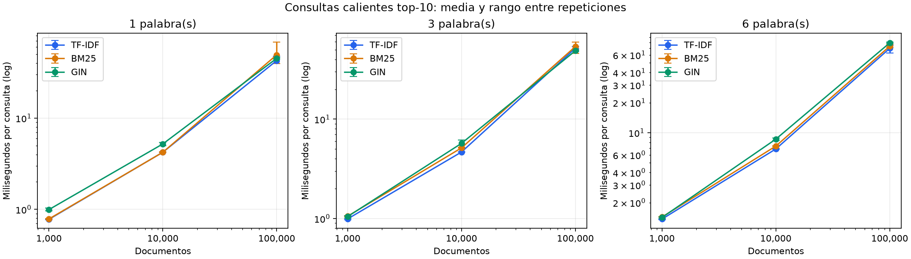

No hay una técnica con la menor media en todos los grupos: TF-IDF gana
en una y seis palabras a 100K, mientras GIN tiene la menor media en tres.
Las diferencias son descriptivas, no una prueba de significancia con solo
tres repeticiones. Las consultas largas tienden a leer más postings y
acumular más candidatos bajo semántica OR. GIN acelera la selección con
`@@`, pero PostgreSQL todavía calcula ts_rank y ordena candidatos. El motor
normaliza o satura pesos y mantiene top-k con heap. Por eso un índice pequeño
o barato de construir no garantiza la menor latencia de ranking.

Las consultas se midieron después de un calentamiento y devuelven IDs y
scores; PostgreSQL incluye el viaje local del cliente al servidor. Los planes
naturales se conservan: en tablas pequeñas PostgreSQL puede preferir Seq Scan.
No se forzó GIN durante las mediciones.

#### 9.3 Relevancia

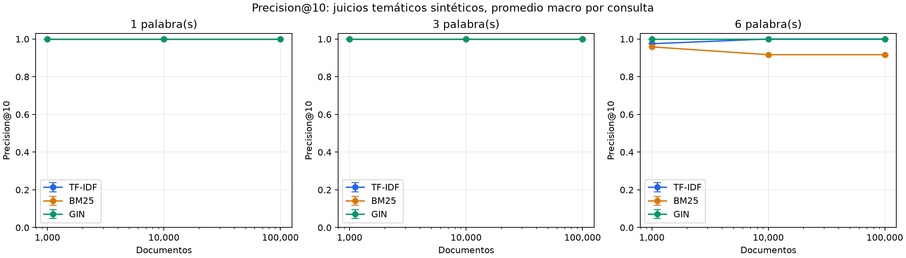
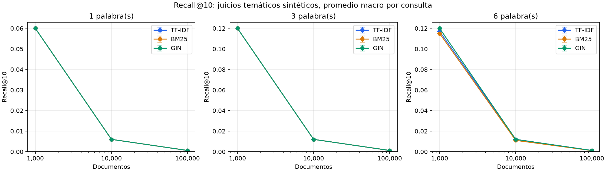

Las consultas de una y tres palabras alcanzaron Precision@10 = 1 en las
tres técnicas y tamaños. Para seis palabras, en 1K TF-IDF obtuvo 0,975,
BM25 0,9583 y GIN 1. En 10K y 100K, TF-IDF y GIN obtuvieron 1, mientras
BM25 obtuvo 0,9167. Estos valores altos reflejan también la sencillez de
las plantillas sintéticas y no equivalen a calidad demostrada en noticias reales.

El caso q16, «energía solar renovable desarrollo proyectos regionales»,
explica la caída de BM25 en 100K: sus diez resultados fueron no relevantes
según el tema principal. Por ejemplo, el documento 14306 trata de banca y
menciona energía solar como noticia secundaria. La consulta añade «desarrollo»,
que también coincide con «desarrolla» en textos de banca tras stemming.
La combinación de frecuencia, longitud y coincidencias permite que esos
documentos superen a noticias solares. Es una explicación compatible con los
textos y la fórmula, no un defecto probado de BM25 ni un ajuste de parámetros
realizado sobre los juicios. Los IDs y scores se pueden auditar en rankings.csv.

Con 100K, Recall@10 fue 0,0006 para consultas generales y 0,0012 para
específicas con diez aciertos. En BM25 de seis palabras fue 0,0011. El recall
baja al aumentar el corpus porque su denominador contiene todos los
documentos relevantes del tamaño correspondiente, mientras el límite sigue
siendo diez. No debe interpretarse esa caída como pérdida automática de
precisión. Los juicios se establecieron por etiquetas editoriales, independientemente
de los resultados de cualquiera de los tres rankings.

#### 9.4 Disco y memoria

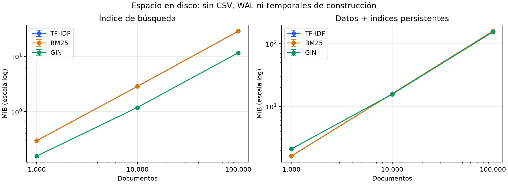
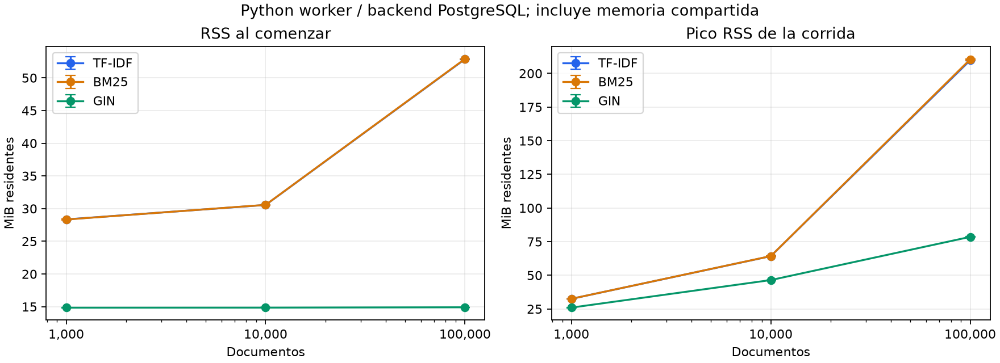

En 100K, SPIMI ocupa 28,500 MiB y GIN 11,570 MiB como índices de búsqueda.
El almacenamiento total es mucho más cercano: 157,913 MiB en el motor y
153,672 MiB en PostgreSQL. El total incluye los textos; PostgreSQL también
conserva el tsvector y la clave primaria. No incluye CSV, WAL ni temporales
de construcción. El menor tamaño de GIN no permite inferir el mismo ahorro
porcentual para toda la base.

El pico RSS observado fue 209,757 MiB para el proceso TF-IDF, 210,424 MiB
para BM25 y 78,556 MiB para el backend PostgreSQL. Son ámbitos distintos:
Python incluye intérprete, qrels y cachés; el backend incluye mappings
compartidos y buffers. El cliente PostgreSQL se mide separadamente en CSV.
Estos números describen residencia del proceso durante la corrida y no
demuestran que el índice GIN necesite solo una fracción de la memoria de SPIMI.

#### 9.5 Ventajas, desventajas y conclusiones

| Técnica | Ventajas en esta implementación | Desventajas y límites |
|---|---|---|
| TF-IDF + coseno | Pesos interpretables, normas precalculadas, buena precisión; menor media en varios grupos | Requiere normalización y acumulación de candidatos; términos con IDF cero no aportan; SPIMI sin compresión |
| BM25 | Saturación de frecuencia y ajuste por longitud; k1 y b configurables; reutiliza SPIMI | Parámetros y corpus afectan el orden; menciones secundarias desplazaron resultados en q16; no ganó en todas las consultas |
| GIN + ts_rank | Índice compacto en esta corrida, mantenimiento integrado y planes inspeccionables; menor preparación completa | GIN no resuelve solo el orden por relevancia; coste previo del tsvector; diccionarios y ranking diferentes al motor |

La evidencia respalda que las tres implementaciones procesan los tamaños
exigidos y permiten auditar tanto eficiencia como calidad. GIN fue ventajoso
en preparación total y espacio del índice en este corpus. TF-IDF mantuvo
latencias competitivas y la mejor media en dos grupos de 100K. BM25 mostró
que normalizar por longitud y saturar frecuencia no garantiza superar al
coseno para toda intención: los distractores del corpus importan.

No se identifica un ganador universal. La decisión depende de si se prioriza
construcción, almacenamiento, latencia de una familia de consultas o relevancia
para una intención concreta. El resultado de q16 también muestra por qué
deben conservarse juicios e IDs, en lugar de comparar únicamente scores.
La exactitud de las fórmulas propias tiene sus pruebas por fuerza bruta;
en este experimento se evalúa calidad temática, que es una pregunta diferente.

Las conclusiones quedan limitadas a noticias sintéticas, caché caliente,
ejecución serial y tres repeticiones en una estación de trabajo. PostgreSQL
usa tablas temporales de sesión y no se está midiendo durabilidad con WAL,
concurrencia ni rendimiento de producción. Un siguiente experimento debería
usar un corpus real con juicios humanos, más repeticiones y consultas de
selectividad variada antes de extrapolar estos resultados.

## Búsqueda multimedia (Parte 4)

### 10. Extensión SQL multimedia

**Tipos `IMAGE` y `AUDIO`.** Una columna multimedia guarda la ruta del archivo y su vector. Igual que `TEXT`, el valor vive en un archivo aparte, `<tabla>.media`, y el registro solo conserva la posición y el largo de su entrada en 12 bytes. Cada entrada tiene el tipo, la ruta en UTF-8 y el vector en `float32`. El vector se extrae una sola vez, al insertar, con `ExtractFeatures` (`engine/features/registry.py`), que se describe a continuación. Si el archivo no existe o no se puede procesar, el `INSERT` falla sin escribir nada. `IMAGE` y `AUDIO` no pueden ser clave primaria, clave de orden físico ni llave foránea, y solo admiten índices HNSW o IVF.

**ExtractFeatures: Bag of Visual/Audio Words.** Sigue el pipeline del enunciado (2.4.1) y de la clase 11:

1. *Patrones locales.* Para una imagen se toman todos sus puntos SIFT (`SIFTExtractor.extract_descriptors`, matriz N × 128, con la imagen en 512 × 512); si no aparece ninguno, se reintenta con umbrales de contraste más bajos. Para un audio, un vector MFCC de 13 coeficientes por ventana deslizante (`MFCCExtractor.extract_frames`, hasta 30 s).
2. *Cuantización.* Un vocabulario de K = 1024 palabras para imágenes y K = 256 para audio, entrenado con K-Means (`engine/features/kmeans.py`) sobre 200 000 descriptores (imagen) o 100 000 (audio) muestreados en proporción a cada archivo de entrenamiento. Cada descriptor se asigna a la palabra más cercana. K-Means asigna los centroides por bloques (memoria O(bloque × K) en vez de N × K × D) y se inicializa con k-means++.
3. *Histograma TF-IDF.* Se cuenta cuántos descriptores caen en cada palabra y se pesa con `(1 + log10 tf) · log10(N / df)`, donde N y df vienen de los archivos de entrenamiento; el vector de K dimensiones se normaliza con L2 (`engine/features/bow.py`).

Los vocabularios están en `models/bow_image_k1024.npz` y `models/bow_audio_k256.npz` (centroides e IDF) y se regeneran con `scripts/download_bow_training_data.py` y `scripts/train_codebook.py`. El visual se entrenó con 500 imágenes del subconjunto `coco1k` (239 659 descriptores SIFT, 200 000 muestreados para K-Means). El de audio, con 200 clips de ESC-50, 4 por cada una de sus 50 clases (K. J. Piczak, 2015, licencia CC BY-NC 3.0). Con esos clips, entre los 3 vecinos por coseno el 25 % es de la misma clase con Bag of Audio Words, frente al 20,5 % del promedio MFCC y al 1,5 % del azar. Una imagen sin ningún punto SIFT no tiene palabras visuales: su vector es nulo y, con el coseno, no se indexa.

*Elección de K para imágenes.* El enunciado no fija K, así que se compararon tres vocabularios sobre las 5000 imágenes de COCO val2017, que no se usaron para entrenar y traen categorías anotadas: SIFT con K = 256 (la primera versión), SIFT con K = 1024 y RootSIFT con K = 2048. Con K = 256 cada imagen activa ~200 de las 256 palabras, los histogramas se parecen todos (coseno medio de 0,69 entre fotos sin relación) y el IDF casi no distingue palabras (su máximo es 0,24).

| Medida (5000 imágenes de COCO val2017) | SIFT, K = 256 | **SIFT, K = 1024** | RootSIFT, K = 2048 |
| :--- | ---: | ---: | ---: |
| Misma foto modificada (48 variantes de la demo entre 5100 fotos): la original sale 1.ª | 92 % | **100 %** | 100 % |
| Ventaja de coseno de la original sobre la 2.ª foto | 0,05 | **0,23** | 0,30 |
| P@10 semántica: misma categoría COCO (azar: 20,5 %) | 27,8 % | 26,7 % | 25,2 % |
| P@10 en las 76 consultas de gatos (azar: 3,7 %) | 5,0 % | 7,0 % | 5,5 % |
| HNSW, N = 5000: construcción / consulta | 15 s / 5,6 ms | 18 s / 6,1 ms | 25 s / 7,6 ms |
| Recall@10, N = 5000: HNSW / IVF | 0,63 / 0,79 | 0,66 / 0,73 | 0,67 / 0,71 |
| Memoria del índice, N = 5000: HNSW / IVF | 20 / 38 MiB | 66 / 127 MiB | 124 / 246 MiB |

Se eligió K = 1024. Es el menor de los tres que encuentra siempre la foto original entre miles de distractores; K = 2048 casi no mejora eso y duplica la memoria de los índices (extrapolada a 100 000 imágenes, IVF pasaría de ~2,5 GB a ~4,9 GB). RootSIFT no aportó una diferencia medible y se descartó. La tabla también muestra el límite del método: ningún K reconoce categorías, y la precisión semántica queda apenas sobre el azar. Como se vio en la clase 10, un descriptor local como SIFT encuentra *el mismo objeto o lugar* aunque cambie el encuadre; la similitud semántica (un gato con otro gato) requiere un descriptor global aprendido, como una CNN o CLIP.

**Índices.** `CREATE INDEX i ON t (col) USING HNSW | IVF [WITH (METRIC = euclidean | cosine | dot)]` crea el índice; la métrica por defecto es la euclidiana. `VectorIndex` adapta `HNSWIndex` e `IVFIndex` al contrato del catálogo: asigna un identificador entero a cada RID, toma los vectores del `<tabla>.media` y se mantiene con cada inserción, eliminación y `ROLLBACK`. HNSW usa `M = 8`, `ef_construction = 50` y `ef_search = 50`. Como HNSW no permite borrar nodos, un borrado deja una marca, la búsqueda pide más vecinos para compensarla y el grafo se reconstruye cuando las marcas superan a los nodos vivos. IVF busca de forma exacta hasta tener 16 vectores; después entrena con `nlist ≈ √N` y `nprobe ≈ √nlist`, y vuelve a entrenar cada vez que la tabla duplica el tamaño del último entrenamiento. Si las listas revisadas no reúnen `k` vectores, revisa más listas, de modo que `k=N` siempre devuelve `min(N, filas)` resultados. Con el coseno, una fila cuyo vector es nulo no se indexa, porque la similitud no está definida. Ambos índices viven en memoria y se reconstruyen desde la tabla al registrarse; al cerrar se guardan en disco.

**Consultas.** Los ejemplos del enunciado se ejecutan tal cual:

```sql
SELECT * FROM imagenes
    WHERE SIMILAR_TO('foto_consulta.jpg', k=10)
    USING HNSW WITH METRIC=cosine;

SELECT nombre, artista, SIMILARITY_SCORE() as score
    FROM canciones
    WHERE SIMILAR_TO('audio_query.mp3', k=5)
    USING IVF WITH METRIC=euclidean
    ORDER BY score DESC;
```

`SIMILAR_TO` no nombra la columna: usa la única columna de la tabla con un índice del método pedido. Si hay varias, se indica como primer argumento, `SIMILAR_TO(foto, 'q.jpg', k=10)`. `WITH METRIC` es opcional y, si aparece, debe coincidir con la métrica del índice, porque el grafo de HNSW y los centroides de IVF dependen de ella. El vector de la consulta se extrae con el mismo extractor de la columna; si el archivo ya estaba insertado, se reutiliza su vector.

`SIMILARITY_SCORE()` siempre crece con la similitud, para que `ORDER BY score DESC` signifique lo mismo con cualquier métrica, como en el segundo ejemplo: el coseno y el producto punto se devuelven tal cual y la distancia euclidiana `d` como `1 / (1 + d)`. El planificador separa `SIMILAR_TO` del `WHERE` y lo pasa al recorrido de la tabla, que entrega los `k` vecinos de mayor a menor similitud. Por eso `ORDER BY SIMILARITY_SCORE() DESC` no agrega un `Sort`. Las demás condiciones del `WHERE` filtran esos `k` vecinos, así que pueden quedar menos de `k` filas. Un `LIMIT` menor que `k` reduce la búsqueda solo si recortar no puede perder resultados.

**Restricciones.** `SIMILAR_TO` solo se admite una vez, en el `WHERE` de un `SELECT` sobre una tabla y unido con `AND`, y no se combina con `MATCH`. `SIMILARITY_SCORE()` requiere ese `SIMILAR_TO` y no se admite con agregación. Ninguno de los nombres nuevos (`IMAGE`, `AUDIO`, `HNSW`, `IVF`, `METRIC`, `SIMILAR_TO`, `SIMILARITY_SCORE`, `K`) es palabra reservada.

**Plan de ejecución.** `EXPLAIN` muestra un nodo `Vector Search` con el índice y sus parámetros, la métrica, `k` y la fórmula de `SIMILARITY_SCORE()`, sin extraer el vector ni buscar. `EXPLAIN ANALYZE` agrega los nodos visitados (HNSW) o los vectores comparados (IVF):

```text
Vector Search using imagenes_foto on imagenes  (cost=4.00..4.00 rows=2) (actual time=0.976..0.993 rows=2 loops=1)
  Vector Cond: similar_to(foto, 'bb.jpg', k=2)
  Index: HNSW (M: 8; ef_construction: 50; ef_search: 50); Metric: cosine
  Score: cosine similarity; Top-k before WHERE
  Nodes Visited: 3; Neighbors Returned: 2
```

**Simplificaciones.** Una misma ruta reutiliza su vector, también tras reabrir la tabla, porque se asume que los archivos no cambian después de insertarse. Eliminar una fila no libera su entrada en `<tabla>.media`. Las rutas relativas se resuelven desde el directorio en que se ejecuta el motor.

### 11. Comparación experimental de índices multimedia (#59)

Se ejecutaron 12 configuraciones sobre imágenes de MS-COCO 2017: 1K, 10K y
100K, con IVF y HNSW bajo distancias euclidiana y coseno. Cada búsqueda pide
diez vecinos y excluye la propia imagen. La referencia de `Recall@10` son los
diez vecinos exactos de los mismos vectores, **no** juicios humanos de relevancia
semántica. Se usó el promedio de descriptores SIFT (128 dimensiones); una
imagen de 10K y otra de 100K sin puntos SIFT usaron un histograma gris de la
misma dimensión, registrado en los metadatos.

> **Pendiente:** estas mediciones son anteriores a ExtractFeatures con Bag of
> Visual Words (sección 10). `benchmarks/multimedia_compare.py` ya usa los
> histogramas BoVW de 256 dimensiones por defecto (`--features sift-mean`
> reproduce esta tabla), y la corrida completa sobre 1K, 10K y 100K se repetirá.
> En una prueba con 500 imágenes de `coco1k`, el Recall@10 bajó de 0,99 a 0,87
> en IVF y de 0,998 a 0,97 en HNSW: los histogramas de 256 dimensiones son más
> difíciles de aproximar que el promedio SIFT de 128.

| Tamaño | Métrica | IVF: construcción | HNSW: construcción | IVF: consulta media | HNSW: consulta media | Recall@10 IVF / HNSW |
|---:|---|---:|---:|---:|---:|---:|
| 1K | Euclidiana | 0,029 s | 0,415 s | 0,459 ms | 0,421 ms | 0,992 / 0,999 |
| 1K | Coseno | 0,023 s | 0,724 s | 0,830 ms | 0,643 ms | 0,990 / 0,993 |
| 10K | Euclidiana | 2,220 s | 34,258 s | 26,973 ms | 3,851 ms | 1,000 / 0,953 |
| 10K | Coseno | 0,472 s | 57,808 s | 4,389 ms | 3,820 ms | 0,995 / 0,952 |
| 100K | Euclidiana | 85,956 s | 363,576 s | 130,637 ms | 2,577 ms | 1,000 / 0,928 |
| 100K | Coseno | 63,695 s | 774,351 s | 113,972 ms | 8,209 ms | 1,000 / 0,911 |

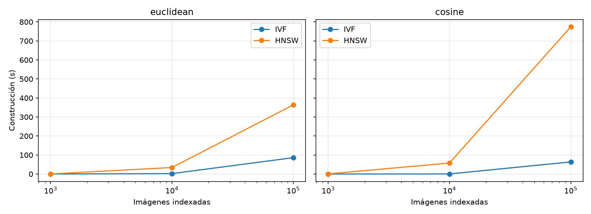
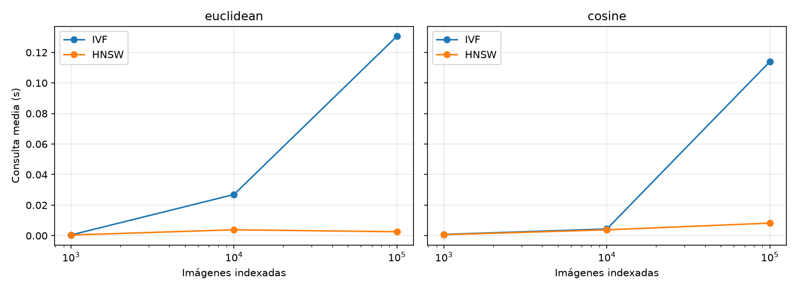
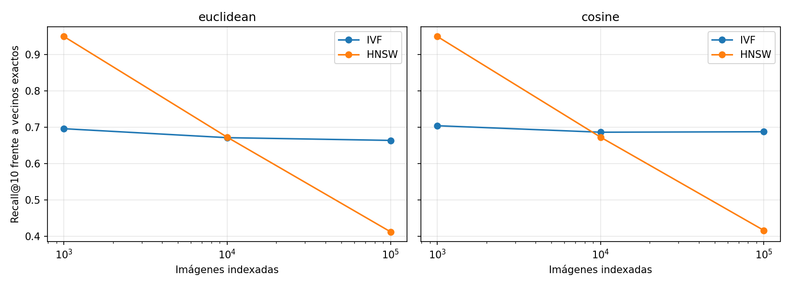
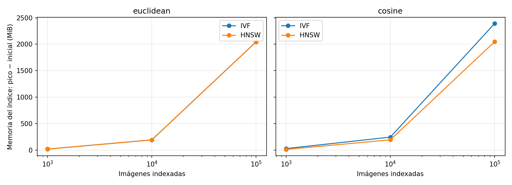

En esta corrida, IVF construyó más rápido y obtuvo mayor Recall@10 en 10K y
100K. HNSW respondió más rápido, especialmente en 100K, a cambio de una
construcción más larga y una pérdida de vecinos exactos con los parámetros
fijados (`M=8`, `ef_construction=50`, `ef_search=50`). Para un corpus que se
reconstruye con frecuencia y tolera consultas más lentas, IVF resultó
conveniente; para consultas frecuentes con tolerancia a aproximación, HNSW
ofreció menor latencia. La elección depende de cuánta pérdida de vecinos se
acepte. El pico de memoria del proceso rondó 2,5 GiB en 100K para ambas
técnicas; incluye vectores, intérprete y páginas compartidas, por lo que no
permite atribuir una diferencia fiable de memoria exclusivamente al índice.

El [informe detallado](../benchmarks/results/multimedia/report.md), los CSV,
las cuatro gráficas y la [galería de casos](../benchmarks/results/multimedia/gallery.html)
permiten auditar cada configuración. La galería compartida carga las fotos
desde el servidor de COCO y requiere internet. Estos números proceden de una
sola corrida por configuración en Windows con Python 3.14; no tienen intervalos
de confianza ni justifican extrapolaciones a otros equipos o a relevancia
semántica de las categorías COCO.
